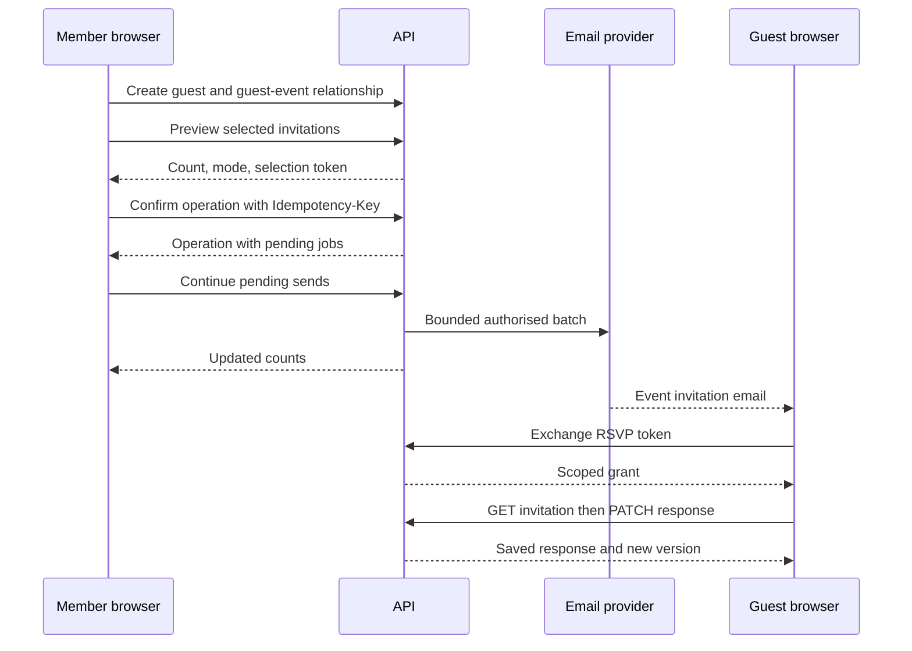

# Make My Marriage — API Design

**Version:** 1.0  
**Date:** 19 November 2026  
**Status:** Implementation contract; endpoints have not yet been implemented or deployed  
**Application:** Next.js App Router / Node.js / TypeScript modular monolith  
**Companions:** [PRD](make-my-marriage-prd-v1.md) · [Architecture](make-my-marriage-architecture-v1.md) · [Database design](make-my-marriage-database-design-v1.md)

## 1. Scope and contract boundaries

This document specifies the application HTTP API for the approved V1. It covers member identity, multiple weddings, one active membership per account, events, individual guests, event-specific invitations and RSVPs, manual email sending, expenses, private photos, and the public website.

Canonical application endpoints use **`/api/v1`**. Endpoint tables below show paths relative to that prefix. Auth.js owns **`/api/auth/[...nextauth]`** outside the versioned application namespace. These concrete paths supersede the illustrative route inventory in the architecture document; no existing deployed API is being migrated.

Pages and server-rendered components can call the same server services directly. The HTTP contract governs browser requests and integration tests; services must enforce the same rules regardless of entry point.

MongoDB collection documents are never returned wholesale. The database design governs persistence; this document governs request DTOs, response DTOs, status codes, and access. Roles and quotas are server-derived. No public database CRUD, job-state editing, quota editing, or administrative recovery API is exposed.

## 2. Common protocol

### 2.1 Requests and representations

- HTTPS in deployed environments. Same-origin browser requests use cookie credentials.
- JSON bodies use `Content-Type: application/json`; JSON responses use `application/json`.
- IDs are 24-character hexadecimal ObjectId strings. Client-generated idempotency keys are opaque strings, not ObjectIds.
- Date-times use ISO 8601 with an offset; the server returns UTC `Z`. Date-only values use valid `YYYY-MM-DD` calendar dates.
- Monetary fields are non-negative integer **paise**. Byte counts are integers. Reject unsafe integers and invalid sums.
- Reject unknown JSON fields, unsupported filter/sort parameters, and MongoDB operator objects. Validate related IDs against the authorised wedding.
- PATCH updates only supplied fields. Explicit `null` clears a documented optional field; required fields cannot be cleared. The database omits cleared optional values.
- Optional output fields are omitted unless the DTO explicitly declares null, such as `membership: null` or `nextCursor: null`.
- Maximum application JSON body is 256 KB. Image bytes go directly to R2 and do not enter this API as multipart/base64 data.
- All responses carry a server-generated `X-Request-Id`. Do not log credential/link values or signed storage URLs.

A resource response:

```json
{
  "data": {
    "id": "507f1f77bcf86cd799439011",
    "name": "Sangeet",
    "version": 3
  }
}
```

A list response:

```json
{
  "data": [],
  "page": {
    "limit": 25,
    "nextCursor": null,
    "hasMore": false
  }
}
```

`204 No Content` has no body. A `201 Created` resource response includes a `Location` header when the resource has a detail endpoint. `202 Accepted` indicates unfinished/pending work, not a promise that a background worker will finish it. HTTP semantics follow [RFC 9110](https://www.rfc-editor.org/rfc/rfc9110.html).

### 2.2 Pagination and filters

List endpoints accept `limit` (default 25, maximum 100) and an opaque `cursor`. Member-invitation lists default to pending; event-invitation lists default to active. Other omitted filters mean all records within the endpoint's authorised, non-deleted scope. The cursor is bound to the wedding/access scope, endpoint, sort, and filters. Invalid or mismatched cursors return `400 INVALID_CURSOR`; clients restart pagination after changing a filter.

Use deterministic sort tuples including `id` as tie-breaker. Lists do not offer arbitrary database sort fields or `includeDeleted`. Summaries supply counts where the UI needs them; list responses do not promise an expensive exact total on every request.

| List | Supported extra parameters | Default order |
| --- | --- | --- |
| Events | None | startsAt ascending, id ascending |
| Guests | `q` bounded plain-text name/email search | name ascending, id ascending |
| Members | `status=active\|revoked` (default active; history restricted to administrators) | joinedAt ascending, id ascending |
| Member invitations | `status=pending\|accepted\|revoked\|expired` | createdAt descending, id descending |
| Event invitations | `eventId`, `guestId`, `status=active\|revoked`, `rsvp=pending\|attending\|declined` | id ascending |
| Expenses | `outstanding=true`, `dueBefore=YYYY-MM-DD` | expenseDate descending, id descending |
| Email operations | `eventId`, `kind`, `status` | createdAt descending, id descending |
| Email jobs | `state` | createdAt ascending, id ascending |
| Gallery | None; ready photos only | createdAt descending, id descending |

### 2.3 Concurrent edits

Editable resource DTOs expose `version`. PATCH requests and versioned action requests include **`expectedVersion`**. DELETE requests supply **`?expectedVersion=3`**, avoiding a DELETE request body.

The server matches the current version and changes it atomically. A mismatch returns `409 VERSION_CONFLICT` with a current version for an authorised resource. Reload and review before retrying; never blindly replace the version and overwrite another person's change. Omitted required version yields `422 VALIDATION_ERROR`.

Token exchange, resource creation, invitation acceptance, email continuation, download URL creation, and upload completion use their own idempotent/state checks instead of arbitrary client version assignment. Authenticated role and ownership checks always use current membership, independently of the version the client submits.

A repeated DELETE of an already deleted/revoked resource in the same authorised scope returns `204`; a different state-changing request still requires its current version. After removing oneself, later requests naturally lose access.

### 2.4 Request idempotency and network retries

`Idempotency-Key` is required for **email-operation creation** and **photo-upload initiation**. It maps respectively to `emailOperations.requestKey` and `photos.clientUploadKey`. Scope it to the authenticated wedding/action or upload grant; do not treat knowledge of a key as authorisation.

- A repeated key and identical canonical input returns the existing operation/photo, without new jobs or a new storage reservation.
- A key reused with different input returns `409 IDEMPOTENCY_KEY_REUSED`.
- The server checks current authorisation before returning any replay result. Replays do not expose a previous member's private response to a removed account.
- Email creation retries look up the existing operation before rejecting an expired preview token; a committed operation can be recovered using its original key/body.
- Resource-backed deduplication survives for the retained operation/photo lifetime. It is distinct from Resend's provider idempotency window.
- A continuation call may claim more pending jobs if repeated. It cannot resend successful jobs from the same operation; clients should fetch progress after a timeout instead of assuming failure.
- Other create endpoints have domain safeguards where available, but do not promise general request deduplication. After an uncertain event/expense creation, refetch the list before submitting again.

## 3. Authentication, access, and cache policy

### 3.1 Access labels

| Label | Meaning |
| --- | --- |
| Public | No account; rate-limited as appropriate |
| Account | Auth.js session with an active user; verification can still be pending |
| Verified | Active session and verified email |
| Member | Verified user with current active membership in the path wedding |
| Admin | Member who is the owner, bride, or groom |
| RSVP | Valid scoped grant for exactly one guest-event invitation |
| Upload | Valid gallery upload grant for the path wedding |
| View | Valid gallery viewing grant for the path wedding |

An authenticated session is not sufficient without the matching active membership. Account-free grants do not grant member authority. Membership and guest attendance are separate concepts.

For missing/invalid member authentication, return `401 AUTHENTICATION_REQUIRED`. For a valid member lacking a required role within their own wedding, return `403 FORBIDDEN`. For another wedding's resource or an ID outside the authorised wedding, return `404 NOT_FOUND` to avoid exposing its existence. The resource's deleted state must not be revealed before these checks.

Origin checks and CSRF protection cover cookie-authenticated custom mutations. Require a same-origin CSRF token for unsafe methods using a dedicated `X-CSRF-Token` header obtained from the bootstrap endpoint. Use a maintained synchronizer or signed double-submit implementation, not just the presence of a header. Auth.js retains its own CSRF protocol. Rate-limit authentication, token exchange, sending, and uploads with shared server-side state.

### 3.2 Guest link exchange

Email and QR links open application pages such as `/invitations/<token>`, `/join/<token>`, `/gallery/upload/<token>`, and `/gallery/view/<token>`. The page submits the token to a purpose-specific exchange endpoint and replaces the address with a clean route. Merely opening a link never confirms attendance, joins a wedding, verifies an email, or resets a password.

Issued HTTP-only grants are Secure in deployed environments, SameSite=Lax, short-lived, signed/encrypted, and scoped by purpose and resource. Each request checks the current token version and record state. RSVP grants bind invitation ID, guest contact revision, and token version; gallery grants bind wedding, access-record ID, purpose, and version. Member-invite grants bind an invitation, and acceptance additionally requires its intended verified email.

Use resource-specific cookie identifiers so opening an invitation for a second event does not overwrite the first grant. Bound cookie expiry/count and allow re-exchange if evicted. A grant's expiration never extends the underlying invitation's expiration.

Token exchanges return only clean paths and safe context; no raw stored token or encryption material. Sensitive pages use `Referrer-Policy: no-referrer` and avoid third-party assets before removing the token from the address.

### 3.3 Caching

All identity, member, RSVP, gallery, download, link, and email responses use `Cache-Control: private, no-store`. Initial public JSON endpoints use no-store as a simple V1 default; public HTML caching can be added with explicit invalidation. Never cache personalised content under a wedding slug alone. R2 read URLs are short-lived capabilities and must not appear in public HTML or unrestricted image caches.

## 4. Error contract

```json
{
  "error": {
    "code": "VERSION_CONFLICT",
    "message": "This expense changed. Reload it before saving.",
    "details": { "currentVersion": 4 }
  },
  "requestId": "req_example"
}
```

Validation details use `fields: [{"path":"paidPaise","message":"Use a non-negative integer."}]`. Never return passwords, submitted tokens, full provider errors, stack traces, storage keys, or other weddings' identifiers.

| Status | Typical codes | Client behaviour |
| --- | --- | --- |
| 400 | `MALFORMED_JSON`, `INVALID_CURSOR`, `INVALID_ID` | Correct syntax/query |
| 401 | `AUTHENTICATION_REQUIRED`, `ACCESS_GRANT_REQUIRED`, `ACCESS_GRANT_EXPIRED` | Log in or reopen the original valid link |
| 403 | `FORBIDDEN`, `EMAIL_VERIFICATION_REQUIRED`, `CSRF_INVALID`, `INVITATION_EMAIL_MISMATCH` | Do not retry unchanged |
| 404 | `NOT_FOUND`, `LINK_UNAVAILABLE` | Show unavailable state |
| 409 | `VERSION_CONFLICT`, `ACTIVE_MEMBERSHIP_EXISTS`, `ROLE_OCCUPIED`, `DUPLICATE_EMAIL`, `SLUG_TAKEN`, `OWNER_PROTECTED`, `IDEMPOTENCY_KEY_REUSED`, `SELECTION_CHANGED`, `STORAGE_LIMIT_REACHED`, `UPLOAD_STATE_CONFLICT` | Resolve or reload |
| 410 | `INVITATION_UNAVAILABLE`, `UPLOAD_EXPIRED` | Previously authorised resource is no longer usable |
| 413 | `REQUEST_TOO_LARGE`, `PHOTO_TOO_LARGE` | Reduce request/file size |
| 415 | `UNSUPPORTED_MEDIA_TYPE`, `UNSUPPORTED_IMAGE_TYPE` | Use accepted content type |
| 422 | `VALIDATION_ERROR`, `GUEST_EMAIL_REQUIRED`, `INVALID_IMAGE`, `SELECTION_TOO_LARGE` | Correct content |
| 429 | `RATE_LIMITED`, `EMAIL_QUOTA_EXHAUSTED` | Honour `Retry-After` if known; retain pending work |
| 503 | `DEPENDENCY_UNAVAILABLE`, `SERVICE_NOT_CONFIGURED` | Retry reads safely; inspect persisted state before mutation retries |
| 500 | `INTERNAL_ERROR` | Display request ID; no internal details |

Error codes are stable API values; human messages may change. An invalid raw token returns a generic unavailable response. A valid earlier grant invalidated by a deletion/contact change can return 410. Quota errors do not mean an email operation was deleted. Individual email failures normally appear in a successful batch-result response, not as one blanket failure hiding partial success.

## 5. Identity and application bootstrap

Auth.js handles credential sign-in and sign-out under `/api/auth/*`; use its supported `signIn`/`signOut` integration and session helpers. Do not invent a second password-login endpoint or promise the application JSON envelope for framework-owned routes. Registration, verification and recovery are application endpoints. [Auth.js sign-in/sign-out](https://authjs.dev/getting-started/session-management/login), [session access](https://authjs.dev/getting-started/session-management/get-session)

| Method | Path | Access | Request → success |
| --- | --- | --- | --- |
| GET | `/csrf` | Public | No input → 200 `{csrfToken}` and required CSRF cookie |
| GET | `/me` | Account | No input → 200 `CurrentUser` |
| POST | `/identity/register` | Public | `{name,email,password}` → 202 generic acknowledgement |
| POST | `/identity/verify-email` | Public | `{token}` → 200 `{verified:true}` |
| POST | `/identity/resend-verification` | Public | `{email}` → 202 generic acknowledgement |
| POST | `/identity/forgot-password` | Public | `{email}` → 202 generic acknowledgement |
| POST | `/identity/reset-password` | Public | `{token,newPassword}` → 200 `{passwordReset:true,signInRequired:true}` |

`CurrentUser`:

```json
{
  "data": {
    "id": "507f1f77bcf86cd799439010",
    "name": "Aarav",
    "email": "aarav@example.com",
    "emailVerified": true,
    "membership": {
      "id": "507f1f77bcf86cd799439012",
      "weddingId": "507f1f77bcf86cd799439013",
      "role": "groom",
      "isOwner": true,
      "version": 0
    }
  }
}
```

An account without active membership receives `membership: null`. Historical revoked memberships are not presented as current access. Password hashes, session versions, and session secrets are not exposed.

Suggested password policy: 12–128 characters, no silent trimming or truncation; hashing and verification follow the architecture. Other field bounds follow the database design. Duplicate registration and unknown recovery email return the same generic 202 acknowledgement: “If this request is eligible, check your email. If nothing arrives, retry later.” Do not expose user existence through an operation ID or provider result.

Eligible identity requests create a single-recipient operation and attempt one bounded send when quota permits. They do not depend on a wedding dashboard. No worker resumes them automatically. A repeated explicit verification/recovery request revokes obsolete unsent challenges, issues a fresh challenge, and tries again. If quota is depleted, return the generic acknowledgement and let the user retry later; expire/cancel stale unsent challenge jobs.

Test delivery to the developer inbox must not verify ownership of another person's address. Before a sender domain exists, end-to-end verification uses only an address controlled by the tester. Reset invalidates prior sessions according to the database sessionVersion rule. Token verification/consumption happens on explicit POST, never email-link GET.

## 6. Weddings, overview, and public information

| Method | Path | Access | Request → success |
| --- | --- | --- | --- |
| POST | `/weddings` | Verified | `WeddingCreate` → 201 `Wedding` |
| GET | `/weddings/{weddingId}` | Member | No input → 200 `Wedding` |
| PATCH | `/weddings/{weddingId}` | Member | `WeddingPatch` → 200 `Wedding` |
| GET | `/weddings/{weddingId}/dashboard` | Member | Optional `eventId` → 200 `Dashboard` |
| GET | `/weddings/{weddingId}/limits` | Member | No input → 200 safe shared-limit availability |
| GET | `/public/weddings/{slug}` | Public | No input → 200 `PublicWedding` |
| GET | `/public/weddings/{slug}/events` | Public | Pagination → 200 list of `PublicEvent` |

`WeddingCreate` required fields: `couple:{brideName,groomName}`, `weddingDate`, `location`, `slug`. Optional: `introduction`, `creatorRole` (bride/groom/manager, default manager). Backend sets owner and creates the active membership and gallery grants transactionally. Reject an existing active membership with 409. A duplicate slug yields `SLUG_TAKEN`; normalise slugs to lowercase URL-safe letters, digits, and hyphens (3–80 characters).

`WeddingPatch`: `expectedVersion` plus any of `couple`, `weddingDate`, `location`, `introduction`, `youtubeUrl`. If supplied, `couple` includes both names. `youtubeUrl:null` removes the stream; a valid URL is parsed into the stored video ID. Slug and owner are immutable through V1 PATCH. Dates are date-only here; event date-times are separate.

All full mutable resource DTOs expose `createdAt`, `updatedAt`, and `version` unless their section explicitly specifies a smaller response. These timestamps describe application records, not provider delivery.

`Wedding`: `id`, `ownerUserId`, `slug`, `couple`, `weddingDate`, `location`, optional `introduction`, optional `youtubeVideoId`, fixed `timezone`, `currency`, `publicUrl`, `version`, `createdAt`, `updatedAt`.

`PublicWedding` exposes only `slug`, `couple`, `weddingDate`, `location`, optional `introduction`, `timezone`, optional constructed `livestream:{embedUrl,watchUrl}`, and `eventsUrl`. It excludes management IDs, owner identity, guests, expenses, gallery links, and invite credentials.

`Dashboard` supplies wedding display details, `guestCount`, event summaries, `expenses:{paidPaise,remainingPaise,totalPaise}`, upcoming due expenses, and email pending counts. If `eventId` is supplied, validate its scope and include `attendance:{invited,pending,attending,declined}` for that event. Counts exclude soft-deleted parents and revoked invitations. Summary values are a current view, not a transactionally frozen snapshot of every module.

`limits` returns email mode, currently available sending allowance/reset estimate if known, `storage:{limitBytes,availableBytes,maxPhotoBytes}`, and whether sends/uploads are enabled. Do not expose other weddings' records, individual usage, provider credentials or the developer test email. The 100-email daily allowance and 8 GB storage cap are shared across the deployment. Authorisation and atomic reservation still happen at mutation time; displayed availability is advisory.

## 7. Members and management invitations

| Method | Path | Access | Request → success |
| --- | --- | --- | --- |
| GET | `/weddings/{weddingId}/members` | Member | Pagination/status → 200 list of `Member` |
| GET | `/weddings/{weddingId}/members/{membershipId}` | Member | No input → 200 `Member` |
| PATCH | `/weddings/{weddingId}/members/{membershipId}` | Admin | `{expectedVersion,role}` → 200 `Member` |
| DELETE | `/weddings/{weddingId}/members/{membershipId}` | Admin | expectedVersion query → 204 |
| GET | `/weddings/{weddingId}/member-invitations` | Admin | Pagination/status → 200 list of `MemberInvitation` |
| POST | `/weddings/{weddingId}/member-invitations` | Admin | `{email,role}` → 201 `MemberInvitation` |
| GET | `/weddings/{weddingId}/member-invitations/{invitationId}` | Admin | No input → 200 `MemberInvitation` |
| POST | `/weddings/{weddingId}/member-invitations/{invitationId}/share-link` | Admin | Empty body → 200 `{url,expiresAt}` |
| DELETE | `/weddings/{weddingId}/member-invitations/{invitationId}` | Admin | expectedVersion query → 204 |
| POST | `/access/member-invitation` | Public | `{token}` → 200 safe invite context, scoped cookie |
| POST | `/member-invitations/{invitationId}/accept` | Verified + invite grant | Empty body → 200 `Member` |

`Member`: `id`, `userId`, `name`, `role`, `isOwner`, `status`, `joinedAt`, `version`; revocation metadata only in Admin-access history. Member detail exposes current data only to ordinary members. No account email/password data is needed for the roster.

`MemberInvitation`: `id`, `weddingId`, `email`, `role`, `status`, `expiresAt`, optional `acceptedAt`, `version`, timestamps. A pending invite for the same wedding/email returns 409; an expired one may be replaced after it is marked expired. Role availability is checked again on acceptance.

Creating a member invitation creates the access record only. Email delivery is an explicit `memberInvitation` email operation (section 11). WhatsApp sharing uses the `share-link` URL and a client-side share action; no server WhatsApp message is sent.

Exchange context: `{invitationId,couple,role,expiresAt,cleanPath}`. Do not return the full intended email to anonymous users. Acceptance requires the logged-in verified email to match, no other active membership, and available role slot. Repeating a completed acceptance by the same user returns the existing still-active membership; it cannot recreate a revoked membership. Rejoining requires a fresh invitation.

Role PATCH applies to non-owner targets in V1; owner changes/removal return `OWNER_PROTECTED`. Removing a non-owner preserves historical membership and content authorship, frees the active slot, and revokes their pending re-entry invitations as specified in the database design. Admins can remove themselves only if they are not the owner; access ends after that response.

## 8. Events

| Method | Path | Access | Request → success |
| --- | --- | --- | --- |
| GET | `/weddings/{weddingId}/events` | Member | Pagination → 200 list of `Event` |
| POST | `/weddings/{weddingId}/events` | Member | `EventCreate` → 201 `Event` |
| GET | `/weddings/{weddingId}/events/{eventId}` | Member | No input → 200 `Event` |
| PATCH | `/weddings/{weddingId}/events/{eventId}` | Member | `expectedVersion` + editable fields → 200 `Event` |
| DELETE | `/weddings/{weddingId}/events/{eventId}` | Member | expectedVersion query → 204 |

`EventCreate`: required `name`, `startsAt`, `location`; optional `endsAt`, `description`. The end must not precede the start. Timezone conversion is performed explicitly by the client/server, not by assuming a browser locale.

`Event`: `id`, `weddingId`, the event fields above, `version`, timestamps. `PublicEvent` contains `id`, `name`, `startsAt`, optional `endsAt`, `location`, optional `description`, without wedding management metadata.

Deleting soft-deletes the event, revokes invitation access and cancels undispatched emails. Emails already dispatched cannot be recalled; their links become unavailable. Changing time/location updates the public and invitation views, but sends no automatic email. An already materialised email operation keeps its frozen payload; cancel unsent work and explicitly create a new operation if a correction must be emailed.

## 9. Guests and event invitation selection

| Method | Path | Access | Request → success |
| --- | --- | --- | --- |
| GET | `/weddings/{weddingId}/guests` | Member | Pagination/q → 200 list of `Guest` |
| POST | `/weddings/{weddingId}/guests` | Member | `{name,email?,phone?}` → 201 `Guest` |
| GET | `/weddings/{weddingId}/guests/{guestId}` | Member | No input → 200 `Guest` |
| PATCH | `/weddings/{weddingId}/guests/{guestId}` | Member | `{expectedVersion,name?,email?,phone?}` → 200 `Guest` plus effects |
| DELETE | `/weddings/{weddingId}/guests/{guestId}` | Member | expectedVersion query → 204 |
| GET | `/weddings/{weddingId}/event-invitations` | Member | Pagination and documented filters → 200 list of `EventInvitation` |
| POST | `/weddings/{weddingId}/event-invitations` | Member | `{guestId,eventId}` → 201 `EventInvitation` |
| GET | `/weddings/{weddingId}/event-invitations/{invitationId}` | Member | No input → 200 `EventInvitation` |
| POST | `/weddings/{weddingId}/event-invitations/{invitationId}/reactivate` | Member | `{expectedVersion}` → 200 `EventInvitation` |
| DELETE | `/weddings/{weddingId}/event-invitations/{invitationId}` | Member | expectedVersion query → 204 |

`Guest`: `id`, `weddingId`, `name`, optional normalised `email`, optional `phone`, `contactRevision`, `version`, timestamps. DTO `email` maps to database `emailNormalized`; no alias is stored as another authoritative email field.

Guests can be created before their email is known. Email is required to send an invitation, not to add the guest/event relationship. Creation of a duplicate guest/event relationship returns 409 with the existing invitation ID only within the authorised wedding. Reactivation is explicit, rotates credentials, and preserves the RSVP for active parents. It sends no email.

`EventInvitation`: `id`, `weddingId`, `guestId`, `eventId`, `status`, `rsvp`, optional `respondedAt`, `guestContactRevision`, `version`, `sendStatus:{currentAddressInvitationSent,currentAddressReminderSent,lastInvitationSentAt?,lastReminderSentAt?}`. Send status derives only from accepted live jobs for the current revision. The member API does not allow directly PATCHing a guest's RSVP or expose raw RSVP tokens; guests respond through the invitation flow.

Guest email correction response:

```json
{
  "data": {
    "id": "507f1f77bcf86cd799439021",
    "weddingId": "507f1f77bcf86cd799439013",
    "name": "Riya",
    "email": "riya.corrected@example.com",
    "contactRevision": 2,
    "version": 5
  },
  "effects": {
    "invitationLinksRotated": true,
    "rsvpsPreserved": true,
    "replacementSendRequired": true
  }
}
```

Normalising to an unchanged email does not rotate links. A genuine change or removal invalidates old links and exchanged RSVP grants, preserves responses, and cancels undispatched old-address jobs. Never alter frozen historic payloads. Soft deletion retains internal records but removes guests from lists and attendance counts. No restoration or permanent-purge endpoint is exposed.

## 10. Account-free RSVP

| Method | Path | Access | Request → success |
| --- | --- | --- | --- |
| POST | `/access/rsvp` | Public | `{token}` → 200 `{invitationId,cleanPath}` plus RSVP cookie |
| GET | `/rsvp/{invitationId}` | RSVP | No input → 200 `GuestInvitationView` |
| PATCH | `/rsvp/{invitationId}` | RSVP | `{expectedVersion,response}` → 200 updated response |

`GuestInvitationView`: `invitationId`, `guestName`, `couple`, `event:{name,startsAt,endsAt?,location,description?}`, `response`, optional `respondedAt`, `version`, and `publicWeddingUrl`. It exposes no guest list, contact information, expenses, or gallery links. `response` is the guest-facing alias of persisted `rsvp`.

PATCH accepts only `attending` or `declined`; pending is the initial server state, not a guest reset action. It rechecks invitation status, non-deleted parents, contact revision, and token version. Revisit and change response using the same valid link. A response to one event never changes another.

```json
{
  "expectedVersion": 0,
  "response": "attending"
}
```

Response: `200 {data:{invitationId,response:"attending",respondedAt:"2026-11-19T12:00:00Z",version:1}}`.

An uncertain retry first reads the current invitation. If the intended response is already saved, no new write is needed; a stale different write returns a version conflict. All details and updates use current link generation, so an old cookie cannot bypass email-correction invalidation.

## 11. Invitations, email operations, and manual continuation

| Method | Path | Access | Request → success |
| --- | --- | --- | --- |
| POST | `/weddings/{weddingId}/email-previews` | Member; Admin for member invites | `EmailSelection` → 200 `EmailPreview` |
| POST | `/weddings/{weddingId}/email-operations` | Member; Admin for member invites | `{selectionToken}` + Idempotency-Key → 201 `EmailOperation` |
| GET | `/weddings/{weddingId}/email-operations` | Member | Pagination/filters → 200 list of `EmailOperation` |
| GET | `/weddings/{weddingId}/email-operations/{operationId}` | Member | No input → 200 `EmailOperation` |
| GET | `/weddings/{weddingId}/email-operations/{operationId}/jobs` | Member | Pagination/state → 200 list of safe `EmailJob` |
| POST | `/weddings/{weddingId}/email-operations/{operationId}/continue` | Member; Admin for member invites | Empty body → 200 batch result, or quota/error response |
| POST | `/weddings/{weddingId}/email-operations/{operationId}/cancel` | Member; Admin for member invites | `{expectedVersion}` → 200 operation with cancellation progress |

Ordinary members cannot list/read member-invitation operations or jobs; list results exclude them. Identity verification/reset operations are never available through wedding routes. An operation's kind determines the role required even when accessed by ID.

### 11.1 Recipient preview and confirmation

Guest `EmailSelection`:

```json
{
  "kind": "guestReminder",
  "eventId": "507f1f77bcf86cd799439011",
  "recipients": {
    "type": "filter",
    "rsvpStatuses": ["pending", "attending", "declined"]
  }
}
```

Other variants:

- `kind:guestInvitation` uses the same event selection shape.
- `recipients:{type:"ids",invitationIds:[...]}` selects explicit event-invitation IDs, not arbitrary email addresses.
- `kind:memberInvitation` requires `memberInvitationId` and omits event/recipients fields; Admin only.

The server selects active invitations, verifies scope and contact availability, and returns `EmailPreview:{kind,eventId?,selectedCount,eligibleCount,excluded:{missingEmail,inactive},mode,availableToday,selectionToken,expiresAt}`. It may include a safe rendered sample with a non-working placeholder RSVP link. Zero eligible recipients yields no actionable selection token. Invalid explicit cross-scope IDs cause an error rather than being silently skipped.

The signed/opaque selection token freezes eligible recipient IDs, contact/token revisions, event content version, kind, actor and wedding scope, and mode for 10 minutes. Use a bounded encoded snapshot; no new database collection is required. This is an implementation default. Cap one operation at 1,000 recipients and direct larger selections into separately confirmed operations; this does not impose a 1,000-guest database limit.

Creation revalidates the token and snapshot. A deleted invite, corrected email, changed event, changed member-invite role, or changed delivery mode returns `409 SELECTION_CHANGED`, with no partial operation created. Newly added guests are not silently included. The user previews again. No arbitrary sender, recipient, HTML body, provider mode, or quota override is accepted from the browser.

Creation persists the operation and jobs but sends **zero emails**. After confirmation, the client explicitly calls Continue once to start sending. The next batch requires another manual continuation. There is no browser auto-loop or unattended background schedule in V1.

### 11.2 Progress contract

`EmailOperation`: `id`, `weddingId`, `kind`, `eventId?`, `mode`, `status` (preparing/open/closed/cancelled), `expectedJobs`, `counts`, `pendingCount`, `eligibleNowCount`, `continueAllowed`, optional `blockedReason`, `version`, timestamps.

`counts` includes every job state: `pending`, `processing`, `accepted`, `deferredQuota`, `retryableFailed`, `permanentlyFailed`, `needsReview`, `cancelled`, `simulated`.

`pendingCount = pending + deferredQuota + retryableFailed`; `eligibleNowCount` also considers backoff, active references, and available quota. Processing and review jobs are shown separately. A closed operation can still contain failures requiring user attention; do not label it “all sent” unless the counts support that statement. Test accepted messages are labelled “test accepted,” never sent to the guest.

`EmailJob`: `id`, `subjectType`, `subjectId`, intended recipient email for authorised members, `state`, `attemptCount`, optional `acceptedAt`, `retryNotBefore`, and sanitised `lastErrorCode`. No raw link tokens, frozen bodies, provider secrets, quota internals, or developer test address.

A continuation handles at most 10 jobs in bounded execution. It claims/reserves atomically, skips accepted/terminal/unresolved jobs, honours backoff, and records partial failures. Response example:

```json
{
  "data": {
    "operationId": "507f1f77bcf86cd799439031",
    "batch": { "claimed": 10, "accepted": 9, "retryableFailed": 1 },
    "pendingCount": 491,
    "continueAllowed": true,
    "quotaBlocked": false
  }
}
```

When no jobs can be claimed solely because quota is exhausted, return 429 with operation ID, pending count and reset estimate if known. If a request processed some jobs before reaching a limit, return 200 with truthful partial results and `quotaBlocked:true`. If all remaining work is processing, in backoff or needs review, return 200 with zero claimed and a reason. Already completed/cancelled operations return their current state without sending.

“Sent” means provider acceptance, not inbox receipt or reading. Retries after an uncertain provider result must follow the database reconciliation path. The public API cannot force `needsReview` into pending or change idempotency keys. Resend's deduplication window is finite; database leases do not provide unconditional exactly-once delivery.

Cancel stops undispatched jobs. It flags dispatched jobs and retains their actual outcome; cancellation cannot recall email. Return `cancellationPending:true` while in-flight outcomes remain unresolved. A new deliberate reminder creates a new operation and may include guests who already received an earlier reminder.

### 11.3 Test mode and quotas

Deployment configuration sets simulated/test/live mode. Test mode delivers only to the configured Resend account address; intended guest identity remains in the job. Simulated mode makes no provider call. Both remain clearly distinct from live guest send history.

All real sends, including verification, recovery and management invites, share the deployment's daily/monthly allowance. Limit previews are advisory; claims enforce actual capacity. A 500-recipient operation remains in the database while successive manual batches and quota windows complete it. There is no promise to deliver 500 messages on one free-tier day.

## 12. Expenses

| Method | Path | Access | Request → success |
| --- | --- | --- | --- |
| GET | `/weddings/{weddingId}/expenses` | Member | Pagination/outstanding/dueBefore → 200 list of `Expense` |
| POST | `/weddings/{weddingId}/expenses` | Member | `ExpenseCreate` → 201 `Expense` |
| GET | `/weddings/{weddingId}/expenses/summary` | Member | No input → 200 INR totals |
| GET | `/weddings/{weddingId}/expenses/{expenseId}` | Member | No input → 200 `Expense` |
| PATCH | `/weddings/{weddingId}/expenses/{expenseId}` | Member | `expectedVersion` + editable fields → 200 `Expense` |
| DELETE | `/weddings/{weddingId}/expenses/{expenseId}` | Member | expectedVersion query → 204 |

Required create fields: `title`, `payerName`, `expenseDate`. `paidPaise` and `remainingPaise` default to zero. Optional: `vendorName`, `notes`, `remainingDueDate`; `firstPaymentDate` and `latestPaymentDate` are required if the resulting paid amount is positive and absent otherwise. Validate the full merged state on PATCH.

`Expense` returns all these values plus `id`, `weddingId`, `totalPaise`, `version`, timestamps. Payer is a text name, not an account reference. A removed member's name and record authorship remain unchanged.

Example balance settlement:

```json
{
  "expectedVersion": 2,
  "paidPaise": 2500000,
  "remainingPaise": 0,
  "latestPaymentDate": "2026-11-19",
  "remainingDueDate": null
}
```

This changes ₹20,000 paid + ₹5,000 remaining to ₹25,000 paid + ₹0 remaining while preserving the original first payment date. No payment-history entry or money transfer is created. First/latest date corrections are explicit edits; latest cannot precede first. When paid becomes zero through an explicit correction, payment dates must be cleared. A zero remaining balance has no active due date.

Summary returns `{currency:"INR",paidPaise,remainingPaise,totalPaise,expenseCount}` with zeros for an empty set, excluding soft-deleted expenses. Expense endpoints are never available to public or guest-link users.

## 13. Gallery links, upload, viewing, and downloads

### 13.1 Endpoints and access

| Method | Path | Access | Request → success |
| --- | --- | --- | --- |
| GET | `/weddings/{weddingId}/gallery-access` | Member | No input → 200 access metadata, without tokens |
| POST | `/weddings/{weddingId}/gallery-access/{purpose}/share-link` | Member | Empty body → 200 `{url,purpose}` |
| POST | `/access/gallery` | Public | `{token,purpose}` → 200 `{weddingId,purpose,cleanPath}` and scoped cookie |
| POST | `/gallery/{weddingId}/uploads` | Upload or Member | `UploadCreate` + Idempotency-Key → 201 `UploadTicket` |
| GET | `/gallery/{weddingId}/uploads/{photoId}` | Matching Upload or Member | No input → 200 `UploadStatus` |
| POST | `/gallery/{weddingId}/uploads/{photoId}/complete` | Matching Upload or Member | Empty body → 200 ready status or 202 processing/retry status |
| GET | `/gallery/{weddingId}/photos` | View or Member | Pagination → 200 list of `GalleryPhoto` |
| GET | `/gallery/{weddingId}/photos/{photoId}` | View or Member | No input → 200 `GalleryPhoto` |
| POST | `/gallery/{weddingId}/photos/{photoId}/download` | View or Member | Empty body → 200 `{url,expiresAt,filename}` |
| DELETE | `/weddings/{weddingId}/photos/{photoId}` | Member | expectedVersion query → 204 deleted or 202 cleanup pending |

`purpose` is strictly upload/view. `gallery-access` returns `{upload:{id,status,version},view:{id,status,version}}`. Sensitive share URLs are returned only on explicit member request, never mixed into public website data or bulk dashboard responses. A QR code is generated client-side from this application URL; no QR-generation backend is required.

A current upload grant authorises status/finalisation only for records created under its access-record ID/version. Upload status contains no photo bytes, preview URL, original read URL, or gallery listing. Members can manage all photos of their wedding. Upload-only visitors cannot delete photos or obtain viewing grants from an upload URL.

### 13.2 Initiation and direct transfer

`UploadCreate`:

```json
{
  "filename": "sangeet-group.jpg",
  "contentType": "image/jpeg",
  "sizeBytes": 5242880
}
```

Only `image/jpeg`, `image/png`, `image/webp`; 1–20,000,000 declared bytes. Canonical filename/contentType/size map to photo metadata fields from the database design. Neither a supplied filename nor MIME is trusted as final proof of content.

`UploadTicket` contains `photoId`, `state`, `upload:{method:"PUT",url,headers,expiresAt}`, and `statusUrl`, `completeUrl`. Headers describe exactly what the signed upload expects; do not expose R2 credentials or permit the browser to select an object key. Reserve original, preview and copy-overlap capacity before returning a URL. Insufficient shared capacity returns 409 and no reservation.

Initial ticket: 201. Same-key replay: 200 using the same photo/reservation. If its upload URL expired and the reservation remains valid with no processing begun, issue a fresh short-lived URL to that same staging record, extend its cleanup deadline, and retain its byte reservation. If it has progressed, return current status without a new write URL. If irreversibly expired/rejected, return a clear state conflict/expiry and require a fresh user upload action.

The browser PUTs original bytes directly to R2 using the returned headers, then calls complete. R2 responses use R2's contract, not this API envelope. A blocked/expired PUT should lead to status inspection or safe ticket renewal, not blind creation of another reservation.

### 13.3 Completion and recovery

Completion verifies stored object size/content and image resource limits, generates the preview, preserves original bytes, and promotes them to a validated final key. Duplicate completion cannot double-charge counters. It is a request-bounded operation, not a background-job promise.

- `200` with `state:ready` means the gallery can display the photo. Upload-only responses still contain no read URL.
- `202` with `state:processing`, `retryAfterSeconds`, `canRetryComplete:false` means another active completion lease owns the work.
- A recoverable interrupted state returns `canRetryComplete:true` after its lease can be safely reclaimed. An explicit repeated POST resumes processing.
- Invalid actual image returns 422 and rejected status. Oversize actual content returns 413. Cleanup/accounting may remain pending after rejection.
- Dependency failures return 503 with `photoId` and a safe recovery instruction. Fetch status before resubmitting.
- GET status never starts processing. The UI can poll status while a request is active, but must not assume an unattended worker will resume interrupted work.

`UploadStatus`: `photoId`, `state`, optional safe `failureCode`, `canRetryComplete`, optional `retryAfterSeconds`. No object inventory, signing keys, quota accounting internals, or read URLs.

### 13.4 Viewing and deletion

`GalleryPhoto`: `id`, `filename`, `contentType`, `sizeBytes`, `width`, `height`, `createdAt`, `version`, `preview:{url,expiresAt}`. Only ready photos are returned. After preview expiry, refetch the authorised list/detail to obtain new URLs. Do not cache these under public website URLs.

Download returns a short-lived signed GET URL for the original uploaded file with a sanitised filename and attachment disposition. Downloading JPEG returns the uploaded JPEG bytes, not the preview. The server verifies viewing scope before each URL issue. URLs already issued remain usable until expiry; revocation prevents new issues but cannot retract a downloaded file.

The member DELETE endpoint removes ready photos and retries an existing deleting state. Earlier upload/rejection states use the existing completion/reconciliation cleanup path; deleting a photo still being processed returns `409 UPLOAD_STATE_CONFLICT`. Member deletion hides the photo immediately and attempts physical cleanup. On pending cleanup, return 202 `{photoId,state:"deleting",cleanupPending:true}`. Repeat DELETE is safe and can retry cleanup; while deleting, stale version checks do not create a second deletion/accounting operation. Once all required objects are confirmed removed, return 204. Reads return unavailable once deletion begins. A failed cleanup retains charged bytes until reconciled.

## 14. Workflow examples

### 14.1 Create wedding and invite a manager

1. Register, verify the controlled email, and sign in through Auth.js.
2. GET `/me`; with no membership, POST `/weddings`.
3. POST the wedding's `/member-invitations` with an email and manager role.
4. Share through `/share-link`, or preview/create a member-invitation email operation and Continue.
5. Recipient exchanges the join token, signs in with the intended verified email, and accepts.
6. Subsequent management requests recheck current active membership and permissions.

### 14.2 Invite selected guests and record RSVP



When guest email is corrected, existing responses persist but old tokens/grants fail. Explicitly preview and create a new invitation operation for that guest's new contact revision; do not continue obsolete-address jobs as if nothing changed.

### 14.3 Upload and download original

1. Scan the upload QR; exchange its token for Upload access.
2. Initiate with a stable key and declared file metadata.
3. PUT bytes to the signed storage URL.
4. POST complete, inspecting status and retrying only as indicated.
5. A viewer exchanges the separate viewing link and loads the paginated gallery.
6. POST download for a selected photo and follow the signed original-file URL.

## 15. Security, scope limits, and implementation rules

- Member IDs, wedding IDs, invited email, resource versions and ownership are validated server-side. A guest token resolves its own scope; the guest cannot choose arbitrary target identities.
- Authenticate/authorise before applying a replay response or revealing a hidden resource's state. Use allowlisted output DTOs, not Mongoose documents.
- GETs never confirm RSVP, send reminders, accept invitations or settle expenses. Link scanners cannot trigger those actions.
- Backend rate limits are distinct from daily email/storage budgets. Both apply. Do not use process memory for global limits.
- Frozen email payloads and post-dispatch uncertainty follow the database design; API error retry flags must not override those invariants.
- Standard role management does not include owner transfer, owner removal, or custom roles. There is no public quota-management endpoint or automatic free-tier upgrade.
- There are no restore/purge, per-payment ledger, gallery ZIP, HEIC/video upload, automated WhatsApp/SMS, webhook-dependent delivery, or automatic reminder endpoints in V1.
- Operational reconciliation of unknown sends, abandoned uploads, and provider records remains an authenticated operator command/tooling task, not a guest/member API capability.
- All numerical constants here are application defaults implementing the confirmed budget. Provider limits and resets remain enforced by the configured service; do not infer provider acceptance solely from local counters.

## 16. Contract verification and handoff

| ID | Contract behaviour to test |
| --- | --- |
| API-01 | Missing session, wrong wedding, and insufficient role return the correct safe error without leaking resource existence. |
| API-02 | Active membership uniqueness, owner protection, removal and later rejoining match the database rules. |
| API-03 | Invalid/unknown fields, malformed IDs, oversize JSON, bad dates and unsafe monetary integers are rejected. |
| API-04 | Cursor scope/filter mismatch fails; deleted records never appear in ordinary lists or totals. |
| API-05 | Stale edits return VERSION_CONFLICT; competing expense writes cannot silently overwrite. |
| API-06 | Raw link GET causes no business mutation; exchanged grants remain purpose/resource scoped and rotation invalidates old grants. |
| API-07 | A guest response changes only its invited event; account-free access reveals no management data. |
| API-08 | Email preview freezes eligible selection; changed content/address causes SELECTION_CHANGED before new job creation. |
| API-09 | Creation-key replays return the original operation, and continuation skips confirmed successes. |
| API-10 | Shared quota exhaustion preserves pending jobs; partial batches report truthful counts and no automatic continuation occurs. |
| API-11 | Test/simulated emails never appear as live guest delivery or verify another person's email ownership. |
| API-12 | Auth recovery acknowledgements do not enumerate accounts; quota exhaustion does not leave an unreachable dashboard-only challenge. |
| API-13 | Upload-key replay creates one reservation; upload-only access cannot list/read/download photos. |
| API-14 | Invalid actual image data is rejected even when declared MIME/size look acceptable; original bytes remain unchanged on success. |
| API-15 | Repeated completion/deletion is accounting-safe; 202 responses specify a real polling/retry path instead of implying an absent worker. |
| API-16 | Public responses/caches omit contact records, expenses, private links, object keys and credentials. |

Implement request/response schemas alongside Route Handlers and service tests. Next deliverables can be an OpenAPI specification, schema code and route implementation derived from this document. The endpoint examples and document structure have been reviewed; no live API, provider send, upload, or integration test was executed for this documentation task.
