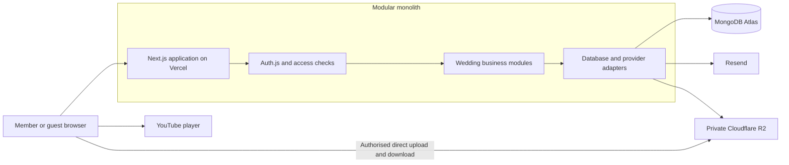
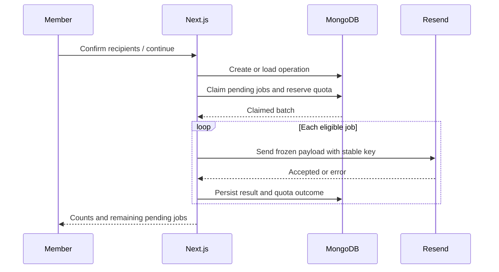

# Make My Marriage — System Design and Architecture

**Version:** 1.0  
**Date:** 16 November 2026  
**Purpose:** Portfolio project and software development practice  
**Status:** Architecture baseline incorporating the confirmed V1 decisions  
**Companion:** [Product Requirements Document](make-my-marriage-prd-v1.md)

## 1. Scope and confirmed decisions

Make My Marriage is a web application for couples, families, and trusted friends to coordinate wedding information. It supports multiple independent weddings. Each wedding has exactly one owner and can have multiple members. Each member account belongs to at most one wedding in V1.

The application includes events, individual guest invitations and RSVPs, manual email reminders, expenses, a basic public wedding website, private photo collection and viewing, and a YouTube livestream link. Guests do not need accounts.

| Area | Confirmed decision |
| --- | --- |
| Architecture | Modular monolith |
| Application | Full-stack Next.js App Router, TypeScript, Node.js runtime |
| Deployment | Vercel Hobby; aim to remain within free allowances |
| Database | MongoDB Atlas |
| Authentication | Auth.js with email/password credentials |
| Email | Resend; application-wide limit of 100 emails per day |
| Email continuation | Manual; show pending count and skip already sent messages |
| Initial email mode | Test delivery to the Resend account email only |
| Real email prerequisite | Configure and verify a sender domain before emailing guests |
| Photos | Private Cloudflare R2 Standard storage |
| Storage budget | 8 GB shared by the entire application, including all weddings and previews |
| Photo formats | JPEG, PNG, WebP; preserve original uploaded files |
| Photo downloads | Individual originals for anyone with gallery viewing access |
| Guest capacity | Design target of approximately 1,000 guests per wedding |
| Livestream | One configured YouTube stream per wedding |

Implementation defaults in this document include Mongoose, JWT sessions, integer-paise monetary values, bounded email batches, and server-generated image previews. They implement the approved scope without adding new product modules. There are no unresolved product decisions blocking implementation.

This document supplements the PRD with implementation choices and service limits. It does not change the PRD's event visibility, member permissions, or guest account requirements.

## 2. System structure

One repository and one Next.js deployment contain the interface, HTTP endpoints, and business logic. External services provide persistence, email delivery, and media storage. A separate Express server, persistent worker, Redis instance, or message broker is not required for V1.



Next.js supports Route Handlers for backend endpoints. Server-rendered pages can call server services directly instead of making an HTTP request to the application's own endpoints. [Next.js backend guidance](https://nextjs.org/docs/app/guides/backend-for-frontend)

### Module boundaries

| Module | Responsibility |
| --- | --- |
| Identity | Registration, credential checks, verification, recovery, sessions |
| Weddings and membership | Wedding setup, ownership, invitations, role assignment |
| Events | Function details and chronological schedule |
| Guests and invitations | Individual contacts, event selection, RSVP links and responses |
| Email delivery | Send operations, jobs, quotas, retry and continuation |
| Expenses | Paid amounts, payer details, balances and due dates |
| Gallery | Link access, upload reservations, validation, previews, downloads |
| Public website | Public projections of wedding data and livestream settings |

Requests follow: **validate input → authenticate or validate access link → authorise → execute service → persist → return a restricted response**. Validation and permission rules live in shared server modules, not only in UI components.

### Suggested code organisation

```text
src/
  app/
    (public)/weddings/[slug]/
    (portal)/dashboard/
    invitations/[token]/
    gallery/upload/[token]/
    gallery/view/[token]/
    api/
  modules/
    identity/
    weddings/
    events/
    guests/
    email/
    expenses/
    gallery/
  lib/
    db/
    access/
    validation/
    providers/
    logging/
  components/
  auth.ts
```

Each module contains its services, models, validation, and response mapping as needed. Provider adapters hide Resend and R2 SDK details from business logic.

## 3. Weddings, ownership, and permissions

A wedding is the data-isolation boundary. Every wedding-specific record carries `weddingId`. Management queries include both the resource identifier and the authorised wedding identifier; the client cannot establish membership by submitting a `weddingId`.

- A verified account with no membership can create a wedding and become its owner.
- A verified account with no membership can instead accept an invitation for its email.
- A unique membership constraint prevents joining or owning a second wedding.
- Wedding creation and owner membership creation occur in one database transaction.
- Invitation acceptance atomically checks the invite, assigns membership, and consumes the invite.
- Ownership is stored on the wedding independently of the member's bride/groom/manager role.
- The owner cannot be removed or transferred in V1.
- The owner, bride, and groom can invite members and assign supported roles. Managers cannot.
- Bride and groom each have at most one role holder per wedding, as specified by the PRD defaults.

| Action | Owner | Bride / groom | Manager | Guest |
| --- | --- | --- | --- | --- |
| Edit wedding, events, guests, expenses, gallery and stream | Yes | Yes | Yes | No |
| Invite management members and assign roles | Yes | Yes | No | No |
| View expenses and guest contact records | Yes | Yes | Yes | No |
| View public schedule | Yes | Yes | Yes | Yes |
| RSVP | Through guest-event invitation | Through guest-event invitation | Through guest-event invitation | Through guest-event invitation |
| Upload/view/download photos | Dashboard or relevant access link | Dashboard or relevant access link | Dashboard or relevant access link | Relevant access link |

An authenticated user can still be an invited guest, but management membership and guest attendance are distinct records. Public pages do not expose guest directories, private link tokens, or expenses.

## 4. Authentication with Auth.js

Use Auth.js's Credentials provider with an explicitly configured JWT session strategy. Application users and password hashes are persisted in MongoDB through application code. An Auth.js database adapter is not required for this credentials-only design.

Auth.js provides the credential authorisation hook and session integration; it does not automatically implement credential persistence, registration, or password recovery. Those are explicit responsibilities of the identity module. [Auth.js Credentials documentation](https://authjs.dev/getting-started/authentication/credentials)

### Member lifecycle

1. Register with name, email, and password; validate and normalise the email consistently.
2. Hash the password using a maintained Argon2id implementation with calibrated resource settings. Never store or log plaintext passwords.
3. Send an expiring, single-use email verification link through the shared email service.
4. Require verified email before creating a wedding or accepting a membership invitation.
5. Authenticate through the Credentials `authorize` callback by verifying the stored password hash.
6. Use Auth.js to establish the session; log out through its supported mechanism.
7. Implement forgotten-password requests with generic responses and expiring, single-use reset tokens. Updating a password increments a user `sessionVersion` to invalidate older sessions at application access checks.

Auth.js JWT sessions use an encrypted token in an HTTP-only cookie. Configure secure cookies in deployed environments, an explicit expiry, and a strong server secret. [Auth.js session strategies](https://authjs.dev/concepts/session-strategies)

Store only necessary identity claims in the session. Protected operations load current user status, session version, and membership from the database; they do not trust a stale role embedded in a JWT. Use shared database-backed attempt limits for login and recovery because serverless instance memory is not a reliable global counter. Apply origin/CSRF checks to custom cookie-authenticated mutations as well as Auth.js's own protections.

### Invitation and gallery credentials

Use cryptographically random tokens with distinct purposes: member invitation, RSVP, gallery upload, gallery view, verification, and password reset. Hash tokens for lookup. Tokens which must be reissued verbatim, such as an RSVP link in a later reminder, require encrypted recoverable storage with a server-only key in addition to the lookup hash. Never log raw tokens.

Invitation and gallery URLs exchange their token for a scoped HTTP-only access cookie and redirect to a clean URL where practical. Validate scope on every relevant operation. Use a no-referrer policy on sensitive link pages. Guest access never creates a management session.

## 5. Data model and consistency

Use Mongoose for application models, with explicit server-side input validation and MongoDB indexes. MongoDB unique indexes enforce uniqueness across concurrent requests. [MongoDB unique indexes](https://www.mongodb.com/docs/manual/core/index-unique/)

| Collection | Important fields / relationships |
| --- | --- |
| `users` | Normalised email, name, password hash, verified time, session version |
| `authTokens` | User/email, purpose, token hash, expiry, consumed time |
| `weddings` | Owner user ID, couple names, date, location, public slug, introduction, stream video ID |
| `memberships` | User ID, wedding ID, bride/groom/manager role |
| `memberInvitations` | Wedding ID, intended email, role, token material, expiry, acceptance state |
| `events` | Wedding ID, name, start/end time, location, description, active state |
| `guests` | Wedding ID, name, normalised email when present, optional phone, active state |
| `eventInvitations` | Wedding ID, guest ID, event ID, RSVP state, response time, token material, send timestamps |
| `emailOperations` | Wedding ID, type, selected invitation IDs, creation key, creator, mode, counts |
| `emailJobs` | Operation ID, recipient, payload snapshot, state, idempotency key, lease, provider ID |
| `emailAttempts` | Job ID, time, result, retryability, provider response identifier |
| `expenses` | Wedding ID, title, payer name, paid paise, remaining paise, date, due date, version |
| `galleryAccess` | Wedding ID, purpose, token material, active state |
| `photos` | Wedding ID, original/staging/preview keys, format, size, filename, state, reservation, version |
| `usage` | Shared email window counters and global stored/reserved byte counters |
| `rateLimits` | Purpose/key, attempt count, expiry |

### Indexes and invariants

- Unique normalised user email and unique public wedding slug.
- Unique `memberships.userId`: at most one wedding per account.
- Partial unique wedding/role index for occupied bride and groom roles; manager is not unique.
- Partial unique wedding/email index for guests with an email; omit absent emails rather than inserting empty strings.
- Unique wedding/guest/event combination for event invitations.
- Unique operation/recipient-invitation combination for email jobs, plus request idempotency for operation creation.
- Wedding/time indexes for events and expenses; wedding/created-time indexes for photos; operation/state indexes for email jobs.
- Expiry indexes for disposable tokens and rate limits, with expiry also checked in code. Storage reservations must not disappear via TTL before accounting and cleanup are completed.

Verify that guest and event references belong to the same wedding. Use transactions for multi-document invariants, including membership creation, quota reservation, and related job state changes. Database transactions do not make Resend or R2 operations atomic; those use recorded states and recovery steps.

Store money as integer paise. Validate non-negative safe integers. A settled expense updates the existing paid/remaining amounts; its total cost remains unchanged. Use version checks on expense edits to detect concurrent modifications instead of silently losing an update.

Store event instants consistently in UTC and display them in Asia/Kolkata. Preserve date-only fields such as the wedding date as date-only values. Cursor pagination avoids loading every guest or image at once.

## 6. API and page boundaries

Routes below are implementation contracts, not a final OpenAPI specification.

| Interface | Purpose and access |
| --- | --- |
| `/api/auth/[...nextauth]` | Auth.js sign-in/session/sign-out handlers |
| `/api/identity/register`, `/verify`, `/forgot-password`, `/reset-password` | Validated identity lifecycle endpoints |
| `/api/weddings` POST | Create a wedding for an eligible verified account |
| `/api/weddings/:id` GET/PATCH | Member-access wedding details; restricted response |
| `/api/weddings/:id/members` and `/member-invitations` | Role-protected member administration |
| `/api/weddings/:id/events` | Member event CRUD |
| `/api/weddings/:id/guests` and `/event-invitations` | Member guest and invitation CRUD |
| `/api/weddings/:id/email-operations` POST/GET | Create a send operation and inspect progress |
| `/api/weddings/:id/email-operations/:operationId/continue` POST | Process a bounded eligible batch |
| `/api/weddings/:id/expenses` | Member expense CRUD |
| `/api/rsvp/:token` GET/POST | Read/update only the token's guest-event invitation |
| `/api/gallery/uploads/initiate` and `/complete` POST | Token-scoped upload reservation and finalisation |
| `/api/gallery/photos` GET | Paginated authorised gallery view |
| `/api/gallery/photos/:photoId/download` POST | Authorised temporary original download URL |
| `/api/weddings/:id/photos/:photoId` DELETE | Member removal, with retryable storage cleanup |
| `/weddings/:slug` | Public website using an explicit public data projection |

Never rely on a hidden menu or page redirect as the only access control. Use consistent validation/error responses and suitable HTTP statuses. Public GET requests must not change RSVP state; changing a response requires an explicit submission so link scanners cannot confirm attendance accidentally.

## 7. Email operations and manual continuation

### Quotas and development mode

Use a single Resend integration for the application. All weddings share the 100-email daily cap and the configured monthly allowance. The current free plan lists 3,000 emails per month. Authentication and member-invitation emails also use the same quota. Local counters must align with the provider's actual reset window and conservatively respect provider quota responses. [Resend pricing](https://resend.com/pricing)

Use three explicit delivery modes:

- **Disabled/simulated:** Render templates and record simulated attempts without contacting Resend; suitable for load and flow testing.
- **Test:** Redirect actual delivery to the configured Resend account email, label messages as tests, and retain the intended guest separately. Test sends consume provider quota but never mark real guest invitations as delivered/sent.
- **Live:** Use intended recipients only after sender-domain verification and explicit environment configuration.

The default `resend.dev` sender can send testing email to the Resend account email; other recipients require a verified sender domain. [Resend sender restrictions](https://resend.com/docs/knowledge-base/403-error-resend-dev-domain)

Do not treat receipt of a redirected verification message as proof of ownership of someone else's email. Before a domain exists, real identity tests use the actual controlled account email. Seeded development identities are confined to isolated test data; a verification bypass is never enabled on the public deployment.

### Processing contract

1. A member chooses an event, message type, and recipients. Both responded and non-responded invitees can receive reminders.
2. Confirmation creates an operation and one job per selected guest-event invitation. A request key makes double-clicks safe.
3. Freeze each job's recipient and email payload before its first provider attempt. Revalidate event/invitation activity before sending. A later deliberate reminder creates a new operation with current event details.
4. The dashboard shows pending, processing, sent, failed, quota-deferred, and uncertain counts, and a **Continue pending sends** button.
5. Each request atomically claims a small eligible batch with an expiring lease and reserves shared quota. Start with 10 jobs per continuation request; tune only after runtime testing.
6. Send with bounded concurrency, respecting provider rate limits. Record the result of every attempted job.
7. Skip all jobs already accepted by the provider. Confirmed retryable failures can be claimed again; rejected addresses require correction.
8. On quota exhaustion, retain pending jobs. A member returns and presses Continue when allowance is available. No daily scheduler or autonomous worker is required.

Closing the browser does not erase jobs. The current request may complete or be interrupted; a later continuation recovers from persisted states. Completion of all jobs is not guaranteed until someone resumes the operation.



### Duplicate prevention and uncertain sends

Resend retains idempotency keys for 24 hours. Retry an uncertain request with the same key and identical payload only within the supported window. If the provider accepted a message but the application failed to record that result, do not assume an expired processing lease means it was unsent. [Resend idempotency](https://resend.com/docs/dashboard/emails/idempotency-keys)

After the idempotency window, unresolved sends move to `needsReview` rather than being blindly retried. Reconcile with provider records before releasing quota or sending again. Count uncertain attempts conservatively. This design avoids claiming unconditional exactly-once delivery across the database and email provider.

The dashboard's **Sent** means accepted by Resend, not read by the recipient. Sending a reminder never changes RSVP status. Prevent accidental concurrent duplicate campaigns, while allowing a new intentional reminder operation later.

## 8. Photo pipeline and shared storage

### Storage and access

Use a private R2 Standard bucket with unique server-generated object keys. Store original images unchanged, plus derived previews. R2 supports temporary signed URLs for direct uploads and reads. [R2 presigned access](https://developers.cloudflare.com/r2/api/s3/presigned-urls/)

The confirmed application storage limit is **8,000,000,000 bytes (8 GB)** across all weddings, including originals, previews, staging files, and active upload reservations. The maximum original is **20,000,000 bytes (20 MB)**. These decimal units keep the UI and counters consistent.

R2 Standard currently includes 10 GB-month and operation allowances with free egress. The 8 GB application budget leaves headroom but is not a provider billing ceiling: operations, other account usage, or untracked files can still incur charges. [R2 pricing](https://developers.cloudflare.com/r2/pricing/)

All environments using that allowance must use the same quota accounting or explicitly reserved sub-budgets whose sum stays within 8 GB. Separate database namespaces alone do not create separate free allowances. Prefer local fixtures and small isolated test uploads.

### Upload workflow

1. Validate the upload token and rate limit. Check declared type and size, then atomically reserve room for the original, preview allowance, and any temporary copy overhead.
2. Create a pending photo record and short-lived signed PUT URL for a unique staging key. Configure R2 CORS for application origins only.
3. The browser uploads directly to R2; the original does not pass through a Next.js request body.
4. A completion request checks the object exists and verifies actual length and content. Decode the supported image with explicit pixel/resource limits; a MIME header or filename alone is insufficient validation.
5. Generate a bounded preview using a server-side image library such as Sharp. Preserve original bytes for download. The server may read the image from R2 during processing; this is separate from accepting a large browser request body.
6. Promote the validated original to a final key for which no client write URL was issued. Bind validation/copy to the checked object version or ETag so a reusable staging URL cannot replace the validated original mid-finalisation.
7. Persist final metadata, transition the photo to `ready`, and adjust reservations to stored bytes. Gallery queries return only ready photos.
8. Retryable processing failures retain a recoverable state. Invalid files are removed and reservations released only after cleanup is confirmed.

Server image decoding and preview generation must be benchmarked within the configured Vercel runtime. Process one completion at a time per photo with a lease; duplicate completion requests must not double-count bytes or create duplicate previews.

### Downloads and cleanup

- Validate viewing access or membership before listing photos or generating a read URL.
- Download the original using a short-lived signed URL and a sanitised filename/content-disposition.
- Keep previews private as well; do not route private images through an unrestricted shared cache.
- Removing a photo immediately hides it, then deletes original and preview objects. Release accounted bytes only once deletion succeeds.
- Expired uploads and failed deletions are reconciled by a bounded maintenance command and opportunistic cleanup during upload administration. V1 has no always-running cleanup worker.
- Do not release a staging reservation while its upload URL can still be used. Account for abandoned objects until deleted.
- When capacity is full, reject new reservations with a clear message. Viewing and downloading existing photos continues.

QR codes contain application upload or viewing links, not expiring R2 object URLs. Sharing a viewing link grants access to all ready photos in that wedding, including individual original downloads. No account or identity verification is required for guests.

## 9. Events, RSVP, expenses, and public website

### Events and RSVP

A wedding has multiple events with independent guest selections. A unique guest-event invitation stores `pending`, `attending`, or `declined`. Updating one response never changes another event's response. Public schedules show all events; invitation selection controls RSVP eligibility rather than event visibility.

Deleting a guest or event first marks it inactive and invalidates dependent access. Pending email jobs check active state before sending. Existing links return an unavailable response. Avoid immediate destructive cascades that lose the information needed to reconcile a send already in progress.

### Expenses

All wedding members can read/edit expenses; guests cannot. An expense contains paid and remaining amounts, payer name, date, optional due date, vendor name, and notes. Totals are computed from active records. Example: 20,000 rupees paid + 5,000 remaining becomes 25,000 paid + 0 remaining after settlement, without creating a duplicate obligation.

### Public website and livestream

Public wedding pages use a restricted data projection and a unique slug. Changes invalidate any relevant public cache. Personalised RSVP, dashboard, and private gallery responses use private/no-store policies. V1 uses refresh or refetch for shared updates; WebSockets are unnecessary.

Parse and validate the configured YouTube URL into an allowed video identifier. Construct a known embed URL instead of storing arbitrary embed HTML. Hide the section when no stream is configured and retain an Open on YouTube fallback.

## 10. Deployment, configuration, and operations

Deploy the Next.js application on Vercel using Node.js runtime endpoints for database, credentials, provider SDKs, and image processing. Choose a supported Node.js version and compatible package versions during implementation, pin them in the lockfile, and verify the resulting build.

Reuse the MongoDB connection/pool within each server runtime where possible; do not create a new connection for every operation. Keep pool sizes bounded because multiple Vercel instances may each have a pool. Prefer an Atlas region near the chosen application region.

Persistent state belongs in MongoDB or R2. Local files and in-memory flags are not durable coordination mechanisms. Next.js documents execution and filesystem limitations for function-based deployments. [Next.js deployment considerations](https://nextjs.org/docs/app/guides/backend-for-frontend#deployment-environment)

### Configuration inventory

| Configuration | Purpose |
| --- | --- |
| `MONGODB_URI`, database name | Atlas connection and environment namespace |
| `AUTH_SECRET`, application origin | Auth.js sessions and correct application URLs |
| Token encryption key | Recoverable RSVP/gallery token material |
| `RESEND_API_KEY`, sender, test recipient, email mode | Email delivery configuration |
| Email daily/monthly limits and window configuration | Shared quota enforcement |
| R2 account/bucket/access credentials | Private storage integration |
| Storage byte limit and image byte limit | Global 8 GB and per-photo 20 MB defaults |

Secrets are server-only and never use public environment-variable prefixes. Preview deployments default to disabled/test email and isolated data. Production email remains in test mode until a sender domain is verified.

Log request IDs, operation/job IDs, provider IDs, state transitions, and error classes. Redact passwords, tokens, signed URLs, full email bodies, and unnecessary guest information. Show useful errors for unavailable services without exposing credentials or internals.

Free services do not provide a promise of unlimited weddings or uninterrupted availability. Paginate lists, limit image processing work, and monitor quota use. Backups/exports and recovery are project-operator tasks; do not assume a free database tier includes managed backup coverage. No automatic deletion of old weddings or original photos is part of V1.

## 11. Verification plan

| ID | Required evidence |
| --- | --- |
| V-01 | Wedding A's member cannot read or mutate wedding B's resources through any management endpoint. |
| V-02 | Concurrent create/join requests still produce at most one membership per user and one owner per wedding. |
| V-03 | Managers cannot invite or assign roles; updated roles take effect at server checks. |
| V-04 | Credential login, verification, reset, logout, and session-version invalidation work; secrets never appear in responses. |
| V-05 | Duplicate guest-event creation is rejected; updating one RSVP leaves other event responses untouched. |
| V-06 | Public pages and APIs contain no private contacts, expenses, gallery credentials, or RSVP credentials. |
| V-07 | Concurrent continuation requests do not claim the same job or exceed reserved shared email quota. |
| V-08 | Continue skips successful jobs, preserves pending count, and safely handles interruption and uncertain acceptance. |
| V-09 | Test delivery goes only to the test recipient and never marks a real guest as sent or verifies another person's email. |
| V-10 | Concurrent uploads cannot over-reserve the shared 8 GB budget; failed cleanup does not prematurely release capacity. |
| V-11 | Unsupported, oversized, corrupt, and resource-exhausting images are rejected; upload links cannot view the gallery. |
| V-12 | Downloaded original bytes match uploaded bytes; previews and downloads require appropriate access. |
| V-13 | Duplicate finalisation and deletion requests do not double-adjust storage counters. |
| V-14 | Expense totals remain correct after partial settlement and conflicting edits are detected. |
| V-15 | Mobile QR upload/view flows, event lists, and YouTube fallback behave as expected. |

Use unit tests for state transitions and calculations, integration tests against a test database for isolation/indexes/transactions, and a small set of end-to-end browser flows. Run a representative test with 1,000 synthetic guests, several events, and a 500-recipient simulated operation. Do not load-test by sending real emails or uploading large volumes into paid-overage storage.

## 12. Implementation sequence and boundaries

1. Set up Next.js/TypeScript, MongoDB connection, validation conventions, and Auth.js credentials.
2. Implement identity lifecycle, wedding creation, membership, roles, and isolation tests.
3. Build event management, the public website, and guest-event RSVP links.
4. Implement durable email operations, quota reservation, test mode, and manual continuation.
5. Add expenses, totals, and concurrent-edit handling.
6. Add private R2 uploads, preview processing, storage accounting, downloads, and cleanup tooling.
7. Integrate dashboard summaries, YouTube settings, error states, deployment configuration, and end-to-end verification.

V1 excludes automated reminders, automatic email continuation, separate worker infrastructure, payments, vendor marketplace/management, household guests, transport, accommodation, tasks, multiple weddings per account, custom roles, HEIC/video uploads, gallery ZIP exports, facial recognition, and self-hosted livestreaming.

The next development deliverables can be database schemas/index definitions, detailed API contracts, and implementation tasks derived from this architecture. No new product decisions are required to begin that work.
