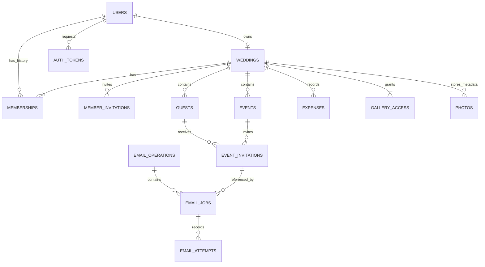
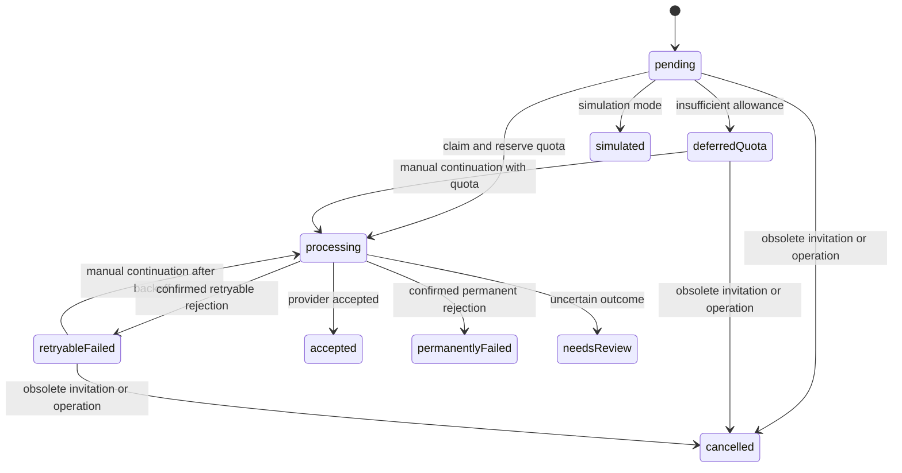

# Make My Marriage — Database Design

**Version:** 1.0  
**Date:** 19 November 2026  
**Status:** Implementation design based on approved V1 scope; schemas and indexes have not yet been deployed  
**Database:** MongoDB Atlas, accessed through Mongoose in the Next.js Node.js runtime  
**Companions:** [PRD](make-my-marriage-prd-v1.md) · [System architecture](make-my-marriage-architecture-v1.md)

## 1. Design decisions and scope

The application supports multiple independent weddings. Each wedding has one permanent owner and multiple members. A user can have **one active wedding membership at a time**; removed memberships remain as history. The owner, bride, and groom can remove non-owner members. A removed user can subsequently join or create another wedding. Ownership transfer and owner removal are outside V1.

Approved lifecycle decisions are implemented as follows:

| Decision | Database consequence |
| --- | --- |
| Remove a non-owner member | Revoke the membership; retain history; free the active-membership slot |
| Delete a guest, event, or expense | Soft-delete the record; exclude it from ordinary queries and totals |
| Delete a guest or event | Revoke affected invitation access and cancel unsent emails; retain responses and send history |
| Correct a guest's email | Increment the guest contact revision; rotate that guest's active invitation tokens; preserve RSVPs; require explicit replacement sending |
| Pay an expense balance | Update cumulative amounts and latest payment date; retain the first payment date |
| Continue email sending | Select only eligible unfinished jobs; never resend confirmed successful jobs in the same operation |
| Store photographs | Store metadata and accounting in MongoDB; store image bytes in private R2 |
| Shared quotas | One application-wide email budget and one 8 GB photo budget across all weddings |

The design targets roughly 1,000 guests per wedding. This is a test target, not an enforced maximum number of guests or an unlimited-weddings guarantee. No family guest groups, payment ledger, task management, vendor module, or ZIP gallery download is added.

This document is authoritative for field names, lifecycle rules, and index definitions. The PRD governs product behaviour; the architecture governs deployment and service boundaries. The approved refinements above supersede earlier permanent-membership wording.

## 2. Conventions and enforcement

### 2.1 Types and shared fields

All collections use the following fields unless explicitly stated otherwise:

| Field | Type | Rule |
| --- | --- | --- |
| `_id` | ObjectId | Generated by application/driver; `usage` uses deterministic string IDs instead |
| `createdAt`, `updatedAt` | BSON Date | Required UTC timestamps; server assigned |
| `schemaVersion` | Integer | Required, default `1`; identifies document shape |

Mutable business records also have `version: integer = 0`. Updates that depend on a previously read state match the expected version and increment it. Use one version mechanism consistently; Mongoose's default `__v` must not become a second competing counter. Set the model version key to `version` and explicitly handle query-based updates.

`ObjectId?` and other `?` types mean optional. Unless a nullable field is explicitly described, omit optional fields instead of storing empty strings or null. Required references are never null. MongoDB does not enforce foreign keys; services validate existence, scope, and state.

Every wedding-specific collection has required `weddingId: ObjectId`. Identity records and global quota/rate-limit records are exceptions. Email operations can be global for verification/recovery; their wedding ID is optional under the discriminated rules below.

### 2.2 Soft deletion

`events`, `guests`, and `expenses` share:

```text
isDeleted: boolean = false       // required; never omitted
deletedAt?: Date
deletedBy?: ObjectId             // acting member's user ID
```

Deleting sets all three fields. Active queries explicitly include `isDeleted: false`. No TTL index removes these records. Restore is a future UI feature; retained data makes an operator recovery possible, but recovery must check current unique constraints and issue new invitation credentials rather than revive revoked links automatically.

Memberships use `status: active | revoked` instead of soft-delete flags. Photos use their processing/removal lifecycle because R2 deletion needs accounting. Email records preserve outcomes and are not soft-deleted as ordinary wedding content.

### 2.3 Validation

- Trim email input and consistently lowercase it for V1 identity matching. Preserve a display email if needed. Do not strip dots or plus-tags. User emails are unique globally; guest emails are unique only among active guests of the same wedding.
- Store date-only values as valid calendar strings `YYYY-MM-DD`; regex alone is insufficient validation. Event instants are UTC BSON dates, displayed in `Asia/Kolkata`.
- Store INR amounts as non-negative integer paise using safe JS integers/BSON numbers. Validate `Number.isSafeInteger` on amounts and totals; never use fractional rupees in storage.
- Byte counters are non-negative safe integers. The shared cap is `8_000_000_000`; each original is at most `20_000_000` bytes.
- Bound input lengths: names/titles 150 characters, descriptions/notes 5,000, venue text 500, email 254, phone 32, photo display filename 255. These are implementation defaults, not new user-facing modules.
- Allowlist accepted writable fields. User input cannot set role, ownership, quota counters, provider IDs, deletion metadata, or processing states through generic updates.
- Mongoose validation, explicit service checks, and database indexes work together. Do not assume update validators enforce cross-field or cross-document rules. Database validators should enforce critical required types/enums on direct writes as well.

### 2.4 Sensitive token envelope

Reusable invitation/gallery tokens use a common embedded shape:

```text
token: {
  hash: string,                 // SHA-256 of high-entropy random token; lookup only
  ciphertext: string,           // authenticated encryption; never plaintext
  keyId: string,                // server-managed encryption key identifier
  nonce: string,
  tag: string,
  version: integer,             // increment on rotation; included in scoped grants
  issuedAt: Date
}
```

Use a maintained cryptographic implementation with random tokens and nonces; bind purpose, record ID, wedding ID, and version as authenticated encryption context. Do not expose these fields in ordinary responses. Recoverable encryption is needed to reshare an existing RSVP/gallery link. Short-lived auth tokens need only a hash in their own collection; their email payload may contain the encrypted raw link until it is no longer needed.

A scoped guest cookie must identify the record and token version, be protected against tampering, and be checked against current database state. Rotating the URL also invalidates previously exchanged access grants. Token expiry and revocation are checked in application code, independently of cleanup.

## 3. Relationships and collection boundaries



The diagram describes persisted references, not database-enforced foreign keys. Each user has at most one active membership; historical revoked rows do not count. An owner must have an active membership in their owned wedding. Global auth email jobs have no event invitation.

Reference growing lists in separate collections. Embed bounded data such as couple names, a token envelope, object metadata, and a lease. Do not store an unbounded guest array, photo array, attempt history, or recipient array on a wedding/operation document.

## 4. Identity and membership collections

### 4.1 `users`

| Field | Type / default | Constraint or purpose |
| --- | --- | --- |
| `name` | String | Required display name |
| `emailNormalized` | String | Required, globally unique |
| `passwordHash` | String | Required Argon2id encoded hash; excluded from default projections |
| `emailVerifiedAt` | Date? | Absent until verified |
| `status` | `active` / `disabled`, default active | Used by access checks; account deletion is outside V1 |
| `sessionVersion` | Integer, default 0 | Password reset invalidates older session claims |
| `version` | Integer, default 0 | Concurrent identity/membership operations can coordinate through this record |

Auth.js uses the Credentials provider and JWT sessions. User persistence and password lifecycle belong to the application. There is no required `sessions` or OAuth `accounts` collection in V1. Current user state and active membership are read for protected operations. Historical membership is never used as authorisation.

### 4.2 `authTokens`

| Field | Type / default | Constraint or purpose |
| --- | --- | --- |
| `userId` | ObjectId | Required reference to user |
| `purpose` | `verifyEmail` / `resetPassword` | Required |
| `emailNormalized` | String | Address to which the challenge applies |
| `tokenHash` | String | Required, unique |
| `issuedSessionVersion` | Integer | Reset/verification binds to current account generation where applicable |
| `expiresAt` | Date | Required; suggested defaults: verification 24 hours, reset 30 minutes |
| `consumedAt`, `revokedAt` | Date? | Single-use state |

Token consumption and the resulting user update are one transaction. A reset increments `sessionVersion` and revokes other outstanding reset tokens. A delayed email whose token has expired is cancelled; a new request issues a new token. Never mark a different person's email verified because a test redirect reached the developer inbox.

### 4.3 `weddings`

| Field | Type / default | Constraint or purpose |
| --- | --- | --- |
| `ownerUserId` | ObjectId | Required; immutable in V1; unique across weddings |
| `slug` | String | Required unique public URL identifier |
| `couple.brideName`, `couple.groomName` | String | Required; independent of role-holder accounts |
| `weddingDate` | Date-only string | Required after setup |
| `location` | String | Required wedding location text |
| `introduction` | String? | Public introduction |
| `timezone`, `currency` | `Asia/Kolkata`, `INR` | Fixed V1 values |
| `youtubeVideoId` | String? | Validated video identifier, not arbitrary HTML |
| `version` | Integer, default 0 | Wedding edits and membership/role transaction coordination |

Creation atomically inserts wedding, owner membership, and the two gallery access records. Ownership is an attribute of the wedding, not a fourth role. A non-couple creator receives manager role plus owner authority; a creator may instead occupy an available bride/groom role.

### 4.4 `memberships`

| Field | Type / default | Constraint or purpose |
| --- | --- | --- |
| `weddingId`, `userId` | ObjectId | Required references |
| `role` | `bride` / `groom` / `manager` | Required |
| `status` | `active` / `revoked`, default active | Active-only unique constraints |
| `joinedAt` | Date | Required |
| `invitedBy` | ObjectId? | Absent for initial owner creation |
| `revokedAt`, `revokedBy` | Date?, ObjectId? | Required together when revoked |
| `version` | Integer, default 0 | Membership permission fencing |

Revocation retains the row and frees the user's active slot and any occupied couple-role slot. Rejoining creates a new membership record. Actor references on old content remain unchanged. A removed member cannot access the former wedding through an old session. No one can revoke the owner's membership.

### 4.5 `memberInvitations`

| Field | Type / default | Constraint or purpose |
| --- | --- | --- |
| `weddingId`, `invitedBy` | ObjectId | Required |
| `emailNormalized` | String | Intended verified account email |
| `role` | `bride` / `groom` / `manager` | Checked again at acceptance |
| `status` | `pending` / `accepted` / `revoked` / `expired` | Default pending |
| `token` | Token envelope | Required while usable |
| `expiresAt` | Date | Suggested default seven days |
| `acceptedAt`, `acceptedBy` | Date?, ObjectId? | Set together on acceptance |
| `revokedAt`, `revokedBy` | Date?, ObjectId? | Set on revocation |
| `version` | Integer, default 0 | Atomic acceptance guard |

Only one pending invitation per wedding/email. Before replacement, explicitly mark an elapsed pending invite expired in the transaction; wall-clock time cannot be a dynamic partial-index filter. Pending invites do not reserve couple-role slots: acceptance fails clearly if the role has since been filled. A person already active in another wedding cannot accept.

## 5. Wedding content collections

### 5.1 `events`

| Field | Type / default | Constraint or purpose |
| --- | --- | --- |
| `weddingId` | ObjectId | Required |
| `name`, `location` | String | Required |
| `startsAt` | Date | Required UTC instant |
| `endsAt` | Date? | If present, not before start |
| `description` | String? | Public details |
| `createdBy`, `updatedBy` | ObjectId | Required member user IDs |
| `version` | Integer, default 0 | Edit/deletion concurrency guard |
| Soft-delete fields | Shared shape | Default active |

Events may share names; the ID distinguishes them. The public schedule shows every non-deleted event, independently of guest invitation selection.

### 5.2 `guests`

| Field | Type / default | Constraint or purpose |
| --- | --- | --- |
| `weddingId` | ObjectId | Required |
| `name` | String | Required |
| `emailNormalized` | String? | Required before sending; omit if unknown |
| `phone` | String? | Contact detail only; no V1 messaging channel |
| `contactRevision` | Integer, default 0 | Increment when email changes or is removed |
| `createdBy`, `updatedBy` | ObjectId | Required |
| `version` | Integer, default 0 | Concurrency guard |
| Soft-delete fields | Shared shape | Default active |

Active guest email uniqueness is scoped to a wedding. The same person can be a guest in several weddings, irrespective of their management membership. A soft-deleted guest does not block adding a new active guest with that email. These are distinct records; old responses and links are not transferred automatically.

### 5.3 `eventInvitations`

| Field | Type / default | Constraint or purpose |
| --- | --- | --- |
| `weddingId`, `guestId`, `eventId` | ObjectId | All required, same-wedding references |
| `status` | `active` / `revoked`, default active | Controls access and counts |
| `revokedReason` | `guestDeleted` / `eventDeleted` / `uninvited`? | Present when revoked |
| `revokedAt`, `revokedBy` | Date?, ObjectId? | Revocation metadata |
| `rsvp` | `pending` / `attending` / `declined`, default pending | Independent for each event |
| `respondedAt` | Date? | Latest explicit guest response |
| `token` | Token envelope | Rotated when guest email changes |
| `guestContactRevision` | Integer | Revision for which the token is valid |
| `createdBy` | ObjectId | Required |
| `version` | Integer, default 0 | Atomic RSVP/token updates |

One record per wedding/guest/event combination, including revoked records. Re-inviting an otherwise active guest/event reuses the relationship record, rotates its token, and defaults to preserving RSVP history; it requires an explicit organiser action. Deleted parents cannot be re-invited until an operator recovery resolves them.

Do not duplicate authoritative send timestamps here. Derive current-address invitation/reminder send status from successful live `emailJobs` matching the current contact revision. Older successful sends remain historical evidence but are not labelled as sent to the corrected address. A changed email preserves `rsvp` and `respondedAt`.

### 5.4 `expenses`

| Field | Type / default | Constraint or purpose |
| --- | --- | --- |
| `weddingId` | ObjectId | Required |
| `title` | String | Required |
| `vendorName`, `notes` | String? | Optional descriptive information |
| `payerName` | String | Required independent text snapshot; no account required |
| `paidPaise`, `remainingPaise` | Integer, default 0 | Non-negative safe integers; validate their sum |
| `expenseDate` | Date-only string | Date the expense/obligation was recorded for the user |
| `firstPaymentDate`, `latestPaymentDate` | Date-only string? | Both required when paid > 0; absent when paid = 0 |
| `remainingDueDate` | Date-only string? | Relevant only while remaining > 0 |
| `createdBy`, `updatedBy` | ObjectId | User IDs; retained after membership removal |
| `version` | Integer, default 0 | Required optimistic concurrency guard |
| Soft-delete fields | Shared shape | Excluded from totals when deleted |

On the first payment, set both payment dates. Subsequent payments preserve the first date and update the latest date; latest must be on/after first. Amount corrections can explicitly correct dates, but cannot silently clear a positive balance's payment dates. Settling the balance clears the current remaining due date. No instalment history is stored.

`totalPaise = paidPaise + remainingPaise` is derived. For a new payment against an unchanged obligation, increase paid and reduce remaining by the same amount. An intentional cost correction is a separate edit of these cumulative values. Example: `paidPaise: 2000000`, `remainingPaise: 500000` represents ₹20,000 paid and ₹5,000 due.

## 6. Email persistence

### 6.1 `emailOperations`

An operation represents one intentional send request. Its recipient set is materialised as jobs, not an array inside this document.

| Field | Type / default | Constraint or purpose |
| --- | --- | --- |
| `scopeKey` | String | `wedding:<id>` or `user:<id>`; generated server-side |
| `weddingId` | ObjectId? | Required for guest/member messages; absent for identity messages |
| `initiatedByUserId` | ObjectId? | Required for member actions; recovery can be unauthenticated |
| `kind` | `guestInvitation` / `guestReminder` / `memberInvitation` / `verifyEmail` / `resetPassword` | Required |
| `mode` | `simulated` / `test` / `live` | Immutable for this operation |
| `eventId` | ObjectId? | Required for guestInvitation/guestReminder |
| `requestKey`, `requestHash` | String | Idempotent creation; reuse with different input is rejected |
| `status` | `preparing` / `open` / `closed` / `cancelled` | Default preparing |
| `expectedJobs` | Integer | Bounded selected-recipient count |
| `selection` | Bounded object | Optional event/RSVP filter description; not an unbounded ID list |
| `version` | Integer, default 0 | Preparation and cancellation guard |

Create operation and jobs atomically for the V1 recipient limit, with capped payload size and transaction benchmarking. If preparation is chunked, retain `preparing` until the exact frozen recipient selection is fully persisted; no job from an incomplete operation is claimable. Repeated creation uses the same unique scope/request key. Status counts are calculated from jobs; any cached summaries are non-authoritative.

### 6.2 `emailJobs`

| Field | Type / default | Constraint or purpose |
| --- | --- | --- |
| `operationId`, `scopeKey` | ObjectId, String | Required operation reference and server-derived scope |
| `weddingId` | ObjectId? | Must match operation; absent for global identity jobs |
| `subjectType`, `subjectId` | Enum + ObjectId | `eventInvitation`, `memberInvitation`, or `authToken` |
| `subjectKey` | String | Stable type/ID composite; unique within operation |
| `guestId`, `eventId` | ObjectId? | Required for guest jobs; enable targeted cancellation |
| `contactRevision`, `tokenVersion` | Integer? | Guest address/link generation snapshot |
| `intendedRecipient`, `actualRecipient` | String | Test mode redirects only actual recipient |
| `mode`, `kind` | Same enums as operation | Immutable validated copies |
| `payloadCipher` | Authenticated encryption envelope | Frozen recipient, sender, subject, body and template version; includes secrets such as RSVP URL |
| `payloadHash` | String | Hash of canonical frozen payload; detects retry mutation |
| `idempotencyKey` | String | Unique stable value, including environment/mode/job ID |
| `state` | See state machine | Default pending |
| `attemptCount` | Integer, default 0 | Monotonic number |
| `lease` | `{id, until}`? | Random fencing ID and expiry |
| `dispatchStartedAt`, `firstAttemptAt` | Date? | Persisted before provider call |
| `retryNotBefore` | Date? | Provider backoff |
| `providerMessageId`, `acceptedAt` | String?, Date? | Only when provider accepted |
| `quota` | `{dayId, monthId, state}`? | State: reserved / consumed / held / released |
| `cancelRequestedAt`, `cancelReason` | Date?, String? | In-flight cancellation cannot unsend email |
| `lastErrorCode` | String? | Sanitised diagnostic |
| `version` | Integer, default 0 | All state transitions conditional |

Payloads and actual recipients become immutable before the first attempt. A correction creates new jobs in a new explicitly requested operation; never reuse an idempotency key with a different email body. Guest status queries use live mode, matching revision, and accepted jobs. Simulated jobs end in `simulated`, not sent. Test acceptance does not establish guest receipt.

### 6.3 `emailAttempts`

| Field | Type / default | Constraint or purpose |
| --- | --- | --- |
| `jobId`, `operationId` | ObjectId | Required |
| `weddingId` | ObjectId? | Scope when applicable |
| `attemptNo`, `leaseId` | Integer, String | Unique job/attempt number; ties result to claim |
| `startedAt`, `finishedAt` | Date, Date? | Attempt duration |
| `outcome` | `started` / `accepted` / `rejected` / `unknown` | Append attempt then finalise outcome |
| `providerMessageId`, `errorCode` | String? | Sanitised references, no body/tokens |

### 6.4 Job state machine



Expired leases with `dispatchStartedAt` absent can be safely reclaimed, provided the dispatch compare-and-set guarantees the old worker cannot start after losing its lease. If dispatch started, recover through the same key/payload within the provider idempotency window, or mark `needsReview`. Resend documents a 24-hour key window; an elapsed lease is not proof of failed delivery. [Resend idempotency documentation](https://resend.com/docs/dashboard/emails/idempotency-keys)

Manual continuation selects only pending, quota-deferred, and confirmed retryable failures. Accepted, simulated, cancelled, permanently failed, and unresolved jobs are skipped. Unknown attempts retain quota conservatively and require reconciliation. New intentional reminders use new operation IDs and may include previously reminded guests.

## 7. Gallery and storage accounting

### 7.1 `galleryAccess`

| Field | Type / default | Constraint or purpose |
| --- | --- | --- |
| `weddingId` | ObjectId | Required |
| `purpose` | `upload` / `view` | Two distinct records per wedding |
| `token` | Token envelope | Hash lookup and recoverable sharing |
| `status` | `active` / `revoked` | Default active |
| `version` | Integer, default 0 | Guard rotation |

Unique wedding/purpose. Viewing authorises browsing and individual original downloads. Uploading does not authorise viewing. Short-lived R2 URLs are generated on demand and are never stored as permanent file addresses or embedded in QR codes.

### 7.2 `photos`

| Field | Type / default | Constraint or purpose |
| --- | --- | --- |
| `weddingId` | ObjectId | Required |
| `clientUploadKey` | String | Idempotent initiate request within wedding |
| `uploadAccessId`, `uploadAccessVersion` | ObjectId, Integer | Gallery upload grant used |
| `uploadedByUserId` | ObjectId? | Absent for account-free visitor |
| `originalFilename` | String | Sanitised display/download filename |
| `declaredBytes`, `declaredMime` | Integer, String | Untrusted request metadata |
| `state` | `reserved`, `uploaded`, `processing`, `ready`, `rejected`, `deleting`, `deleted` | Default reserved |
| `objects` | Bounded array | At most staging, original, preview entries; shape below |
| `reservation` | Object | `{bytes, expiresAt, state: active/released}`; no TTL deletion |
| `uploadUrlExpiresAt` | Date | Cleanup cannot release reservation before URL is unusable |
| `checksumSha256` | String? | Verified original-byte checksum |
| `width`, `height`, `verifiedMime` | Integer?, Integer?, String? | Verified image metadata |
| `processingLease` | `{id, until}`? | Prevents duplicate finalisation |
| `failureCode` | String? | Sanitised retry/validation reason |
| `deletedAt`, `deletedBy` | Date?, ObjectId? | Member removal metadata |
| `version` | Integer, default 0 | Conditional processing/accounting transitions |

Object entry: `{kind: staging|original|preview, key, bytes, etag?, state: reserved|present|deletePending|deleted}`. Keys are server-generated unique strings with wedding/photo prefixes. Image bytes, base64 data, and expiring URLs are never stored in MongoDB.

Validate actual size, image signature, decodability, and pixel limits before ready state. Preserve the original bytes; previews are derivatives. Finalise into a server-controlled key whose contents are tied to the validated ETag. Account for both copies while promotion overlaps. A ready photo can retain a staging entry awaiting deletion, but that entry still consumes quota.

The current processing state may be rejected while objects still exist. Only confirmed deletion frees their accounted bytes. Expired/failed uploads are reconciled by bounded maintenance or member-driven processing; there is no always-running worker in V1.

### 7.3 `usage`

A discriminated collection with deterministic string `_id` values. All IDs include a deployment-wide shared budget namespace, not wedding IDs.

| Kind / ID example | Required fields | Meaning |
| --- | --- | --- |
| storage / `storage:application` | `limitBytes: 8000000000`, `storedBytes`, `reservedBytes`, `version` | Shared original/preview/staging budget |
| emailDay / `email:account:day:<provider-window>` | `windowStart`, `windowEnd`, `limit: 100`, `consumed`, `reserved`, `held`, `version` | Shared daily delivery allowance |
| emailMonth / `email:account:month:<provider-window>` | Same fields; configured monthly limit | Monthly allowance for same Resend account |

Budget invariant: `storedBytes + reservedBytes <= limitBytes`. Present objects contribute stored bytes. Reserved-but-not-yet-created bytes contribute reserved bytes, including the maximum temporary overhead and preview allowance. Moving bytes from reserved to stored is one transaction with the corresponding photo update. No bytes are charged twice in both counters.

Email invariant: `consumed + reserved + held <= limit` in both the current day and month windows. Claiming a real job reserves one slot in each window transactionally. Provider acceptance converts reservation to consumption. Unknown outcome converts it to held. Confirmed non-acceptance releases it only when provider quota semantics permit. Simulation does not reserve provider quota; test sending does.

Jobs retain the exact window IDs they reserved so a late response settles the original window, not today's arbitrary counter. Do not dispatch an old-window reservation after that provider window closes; release/re-reserve before any unsent request. A cross-window retry of an uncertain dispatch remains a review/reconciliation path, not an ordinary new send. A conservative temporary current-window reservation can be required when provider acceptance timing is unclear.

Provider account limits are the final authority. Out-of-band sends on the same account must be reflected or disable application sending until reconciled. Environment isolation must not multiply the shared account allowances. Storage and email usage records are never deleted by TTL while unresolved references exist.

### 7.4 `rateLimits`

| Field | Type / default | Constraint or purpose |
| --- | --- | --- |
| `scopeKey` | String | HMAC of purpose + identity/IP/access-grant key, avoiding raw identifiers |
| `windowStart`, `expiresAt` | Date | Required bounded window |
| `count` | Integer, default 0 | Atomic increment |

Unique scope/window. An expiring row implements a fixed-window counter, not an application email budget. Serverless processes share these records. Cleanup can use TTL because no financial/storage state depends on them.

## 8. Index catalogue

Use named migrations to create indexes explicitly; do not depend on automatic production index creation. Check for duplicates before adding uniqueness. Index names below are stable implementation identifiers; `_id` indexes exist automatically.

| Collection | Index name and key | Options / query served |
| --- | --- | --- |
| users | `uq_user_email` `{emailNormalized:1}` | Unique |
| authTokens | `uq_auth_token` `{tokenHash:1}` | Unique |
| authTokens | `ix_auth_user_purpose` `{userId:1,purpose:1}` | Revocation |
| authTokens | `ttl_auth_expiry` `{expiresAt:1}` | TTL, expireAfterSeconds 0 |
| weddings | `uq_wedding_slug` `{slug:1}` | Unique |
| weddings | `uq_wedding_owner` `{ownerUserId:1}` | Unique; owner cannot migrate |
| memberships | `uq_active_user_membership` `{userId:1}` | Unique, partial `{status:'active'}` |
| memberships | `uq_active_couple_role` `{weddingId:1,role:1}` | Unique, partial active and role in bride/groom |
| memberships | `ix_wedding_members` `{weddingId:1,status:1,joinedAt:1,_id:1}` | Active roster/history |
| memberships | `ix_user_membership_history` `{userId:1,joinedAt:-1,_id:-1}` | Historical memberships |
| memberInvitations | `uq_pending_member_email` `{weddingId:1,emailNormalized:1}` | Unique, partial pending |
| memberInvitations | `uq_member_invite_token` `{'token.hash':1}` | Unique |
| memberInvitations | `ix_member_invites` `{weddingId:1,status:1,createdAt:-1}` | Invitation list |
| events | `ix_active_event_schedule` `{weddingId:1,startsAt:1,_id:1}` | Partial `{isDeleted:false}` |
| guests | `uq_active_guest_email` `{weddingId:1,emailNormalized:1}` | Unique, partial active + email type string |
| guests | `ix_active_guest_list` `{weddingId:1,name:1,_id:1}` | Partial `{isDeleted:false}` |
| eventInvitations | `uq_guest_event` `{weddingId:1,guestId:1,eventId:1}` | Unique across all states |
| eventInvitations | `uq_rsvp_token` `{'token.hash':1}` | Unique |
| eventInvitations | `ix_event_rsvp` `{weddingId:1,eventId:1,status:1,rsvp:1,_id:1}` | Event status list/counts |
| expenses | `ix_active_expense_list` `{weddingId:1,expenseDate:-1,_id:-1}` | Partial active |
| expenses | `ix_outstanding_due` `{weddingId:1,remainingDueDate:1,_id:1}` | Partial active, remainingPaise > 0, due-date type string |
| galleryAccess | `uq_gallery_purpose` `{weddingId:1,purpose:1}` | Unique |
| galleryAccess | `uq_gallery_token` `{'token.hash':1}` | Unique |
| photos | `uq_upload_request` `{weddingId:1,clientUploadKey:1}` | Unique |
| photos | `ix_ready_gallery` `{weddingId:1,createdAt:-1,_id:-1}` | Partial `{state:'ready'}` |
| photos | `ix_photo_cleanup` `{state:1,'reservation.expiresAt':1}` | Cleanup candidates; not TTL |
| emailOperations | `uq_email_operation_request` `{scopeKey:1,requestKey:1}` | Unique |
| emailOperations | `ix_wedding_operations` `{weddingId:1,createdAt:-1,_id:-1}` | Member operation list |
| emailJobs | `uq_operation_subject` `{operationId:1,subjectKey:1}` | Unique |
| emailJobs | `uq_send_idempotency` `{idempotencyKey:1}` | Unique |
| emailJobs | `ix_operation_jobs` `{operationId:1,state:1,createdAt:1,_id:1}` | Pending counts and claims |
| emailJobs | `ix_guest_job_revision` `{weddingId:1,guestId:1,contactRevision:1,state:1}` | Address correction/cancellation |
| emailJobs | `ix_event_job_state` `{weddingId:1,eventId:1,state:1}` | Event deletion/cancellation |
| emailJobs | `ix_subject_send_history` `{subjectType:1,subjectId:1,mode:1,acceptedAt:-1}` | Current/historical send display |
| emailAttempts | `uq_job_attempt` `{jobId:1,attemptNo:1}` | Unique |
| rateLimits | `uq_rate_window` `{scopeKey:1,windowStart:1}` | Unique |
| rateLimits | `ttl_rate_expiry` `{expiresAt:1}` | TTL, expireAfterSeconds 0 |

Representative mongosh definitions for the approved lifecycle rules:

```javascript
db.memberships.createIndex(
  { userId: 1 },
  { name: 'uq_active_user_membership', unique: true,
    partialFilterExpression: { status: 'active' } }
);
db.memberships.createIndex(
  { weddingId: 1, role: 1 },
  { name: 'uq_active_couple_role', unique: true,
    partialFilterExpression: { status: 'active', role: { $in: ['bride', 'groom'] } } }
);
db.guests.createIndex(
  { weddingId: 1, emailNormalized: 1 },
  { name: 'uq_active_guest_email', unique: true,
    partialFilterExpression: { isDeleted: false, emailNormalized: { $type: 'string' } } }
);
db.authTokens.createIndex(
  { expiresAt: 1 }, { name: 'ttl_auth_expiry', expireAfterSeconds: 0 }
);
```

Partial unique indexes constrain only matching documents; active queries must include the predicate to benefit from their coverage. Supported predicates and examples are documented by [MongoDB partial indexes](https://www.mongodb.com/docs/manual/core/index-partial/). TTL cleanup is asynchronous, so a token must fail immediately at its stored expiry even if its document still exists. [MongoDB TTL indexes](https://www.mongodb.com/docs/manual/core/index-ttl/)

No index is a substitute for an ownership/reference check. Avoid indexing every field: verify representative query plans before adding indexes that increase write cost and storage.

## 9. Transactions and race handling

Use the driver's/Mongoose transaction helper with a session shared by every operation in the transaction. Await operations sequentially inside a transaction. Retry only supported transient failures; map uniqueness conflicts to useful domain errors. Transaction callbacks can be retried, so no Resend sends, R2 writes, or irreversible side effects belong inside them. [MongoDB transaction guidance](https://www.mongodb.com/docs/manual/core/transactions-in-applications/)

### T-01 — Create or join a wedding

Conditionally update the current user's version after checking active identity and email verification; insert an active membership guarded by its unique index. Creation also inserts the wedding and gallery records. Acceptance consumes the member invite and checks that its intended email and role remain valid. Touch the wedding version when assigning/removing couple roles to serialise roster changes. All writes commit or abort together.

### T-02 — Remove a member

Verify the actor is the owner, bride, or groom and the target is not the owner. In one transaction, fence the actor's active membership, update the wedding roster version, and revoke the target with revoker/time metadata. Revoke pending member invitations for the target email in that wedding to prevent unintended immediate re-entry. Cancel their unsent invitation email jobs where applicable. Rejoining later requires a new invitation.

Keep content author IDs and expense payer text. Protected mutations should conditionally touch the actor membership version inside their transaction where they need strict ordering against removal, so a read-only permission check cannot race a later write. Reads use current membership. Any external request already dispatched before revocation cannot be recalled.

### T-03 — Soft-delete guest or event

Mark the parent deleted and increment its version. Revoke dependent active event invitations and cancel jobs that have not dispatched. Retain RSVP values and accepted send history. For jobs already processing after dispatch, set a cancellation request and preserve reconciliation state. Every RSVP/read/send checks parent status, so access fails immediately even if dependent cleanup is processed in bounded chunks.

Invitation creation, RSVP writes, and send-claim validation conditionally touch relevant parent versions inside their transactions when strict ordering is required. MongoDB snapshot reads alone do not stop a parent being deleted concurrently. An external send already in progress cannot be retracted; the emailed link will be unavailable.

### T-04 — Correct guest email

Within a transaction, validate active-email uniqueness, increment guest `contactRevision`, update email, rotate tokens of active invitations, and set each invitation's matching revision. Preserve every RSVP and response timestamp. Cancel old-revision undispatched jobs; flag dispatched jobs for reconciliation. No replacement send is created automatically.

Historical jobs keep the original recipient and encrypted payload unchanged. All guest access checks compare current revision and token version. Member must explicitly send replacement invitations. Previously accepted messages are still visible as historical sends to the old address; current-recipient send status is unsent until a new live job succeeds.

A spelling change after dispatch may still deliver the already submitted email to the old address. Its RSVP credential must already be invalidated; provider delivery cannot be rolled back by MongoDB.

### T-05 — Update RSVP or expense

RSVP checks active parent records, invitation state, token generation, and guest revision, then updates only that invitation's response/time. Guest input never selects its own wedding, guest, or event identifiers independently of the token.

Expense update matches wedding, active state, and version. Validate amounts and first/latest dates, then write together and increment version. On conflict, return a reload/review response rather than silently overwriting. Soft deletion uses the same version guard and immediately excludes the expense from aggregation.

### T-06 — Claim and settle email jobs

Claim eligible jobs with a fencing lease and reserve both quota windows transactionally. A separate conditional write records dispatch start while the lease is owned, immediately before the provider call. Provider acceptance/rejection is settled transactionally with the attempt/job/counters. Update counters only when the job's prior quota state matches; duplicate result processing has no effect.

Lease expiry before dispatch can release/reclaim safely. Lease expiry after dispatch enters reconciliation. Do not release unknown sends and then spend the same capacity again. The job's frozen payload and stable key support retry only within the applicable provider window.

### T-07 — Reserve, finalise, or delete a photo

Atomically reserve bytes and insert the photo using the client request key; the storage counter update must conditionally require enough remaining capacity. A repeat request returns the original reservation instead of charging twice.

R2 work occurs outside the transaction. After verifying object state, update the bounded object inventory and stored/reserved counters in one transaction guarded by photo version and processing lease. During copying, account for source and destination concurrently. On deletion failure keep bytes charged; only confirmed deletion frees them. A repeat completion/deletion must be a no-op for accounting.

The invariant is about managed objects, not a provider-enforced spending cap. Reconcile storage metadata with R2 and account for abandoned writes or objects created outside the application. Signed upload metadata alone cannot prove an uploaded file's real type or size.

## 10. Query patterns and aggregation

Always derive wedding scope from membership or the validated link. Explicit projections exclude password hashes, token envelopes, encrypted payloads, and guest contacts from public routes. Never populate unrelated wedding references into a response.

| Screen / operation | Query pattern |
| --- | --- |
| Current membership | `{userId, status:'active'}` |
| Public schedule | Active wedding's events, sort startsAt then _id |
| Guest list | `{weddingId,isDeleted:false}`; cursor by name/_id |
| Event RSVPs | Active invitations for event, group by rsvp; verify non-deleted parents |
| Expense totals | Active expenses only; sum paidPaise and remainingPaise; derive total |
| Upcoming balances | Active expenses with remaining > 0 and due date; sort due date/_id |
| Email pending count | Group operation jobs by state; exclude accepted/cancelled/terminal jobs from actionable count |
| Gallery | `{weddingId,state:'ready'}`; sort createdAt descending then _id |
| Original download | Ready photo ID + authorised wedding; return short-lived object URL |
| Storage headroom | `limitBytes - storedBytes - reservedBytes` from global counter |

Representative aggregation:

```javascript
db.expenses.aggregate([
  { $match: { weddingId: weddingObjectId, isDeleted: false } },
  { $group: {
      _id: null,
      paidPaise: { $sum: '$paidPaise' },
      remainingPaise: { $sum: '$remainingPaise' }
  } },
  { $project: {
      _id: 0, paidPaise: 1, remainingPaise: 1,
      totalPaise: { $add: ['$paidPaise', '$remainingPaise'] }
  } }
]);
```

Return zeros when no expense rows exist. Use server-validated ObjectIds; never pass a raw request object as a MongoDB filter. Dashboard unique guest counts come from `guests`, not the count of event invitations. A guest invited to three events is one person and three relationships.

Begin with 25-row pages, capped at 100. Cursor tuples include `_id` as a deterministic tie-breaker and are bound to the active filter. Use query `explain` against representative fixtures; basic small-scale name search can be bounded without adding Atlas Search in V1.

## 11. Retention, migrations, and operations

- Preserve weddings, membership history, soft-deleted content, invitations, expenses, send outcomes, and photo accounting records in V1. No automatic purge/restore UI is introduced.
- TTL removes disposable auth tokens and rate windows only. It never removes jobs, usage reservations, or unfinished photo metadata.
- Keep email payloads encrypted and restricted. Future retention policy may scrub completed payloads without erasing recipient/revision/provider outcome metadata; do not purge unresolved jobs.
- R2 deletion is a physical file operation distinct from guest/event/expense soft deletion. Ready images removed by a member become unavailable immediately; cleanup may finish later.
- Maintain schema versioned migration scripts with precondition checks, counts, and an export before destructive changes. Use explicit index migrations and duplicate audits.
- When changing a pre-existing permanent `memberships.userId` unique index, remove it only in a controlled migration that first validates/builds the active-only replacement. Leaving the permanent index in place would still block approved rejoining.
- Align development data and storage namespaces with one shared provider quota or fixed sub-budgets. Credentials and encryption keys remain outside MongoDB in server configuration; backups require controlled access to decryptable data.
- Export/import recovery must preserve ObjectIds, token key identifiers, reference integrity, and accounting state. After recovery reconcile uncertain Resend attempts and R2 inventory before resuming sends/uploads. Do not interpret a database restore as undoing external sends or storage writes.
- The portfolio deployment should use fictional or explicitly provided demo data. Monitor database size as history grows; no claim is made that free storage holds unlimited history.

## 12. Verification and implementation handoff

| ID | Database behaviour to verify |
| --- | --- |
| DB-01 | Concurrent create/join requests produce only one active membership per user. |
| DB-02 | Revocation frees active membership, preserves history, and blocks owner removal. |
| DB-03 | Concurrent couple-role assignment permits at most one active bride and one active groom per wedding. |
| DB-04 | Cross-wedding guest/event references and resource queries are rejected. |
| DB-05 | Optional guest email is omitted; duplicate active emails fail; soft-deleted emails can be reused without reviving old records. |
| DB-06 | Guest/event soft deletion blocks old links immediately, retains responses, and cancels undispatched jobs. |
| DB-07 | Email correction preserves RSVP, invalidates URL and scoped-cookie generations, and requires explicit replacement sending. |
| DB-08 | Expense first/latest dates and totals remain correct through partial/full payment and soft deletion. |
| DB-09 | Simultaneous expense edits produce a conflict rather than a lost update. |
| DB-10 | Continue skips accepted jobs; duplicate claims/results cannot consume quota or send twice within the same recorded operation. |
| DB-11 | Unknown sends, expired leases, and day/month boundaries preserve conservative quota accounting. |
| DB-12 | Test/simulated sends do not update live invitation status or verify unrelated account emails. |
| DB-13 | Concurrent uploads cannot reserve beyond 8 GB; preview/copy/staging overhead is included. |
| DB-14 | Repeated photo finalisation/deletion cannot double-count or prematurely free bytes. |
| DB-15 | Expired tokens fail before TTL deletion; private fields never enter public response projections. |
| DB-16 | Index migration from permanent to active-only membership permits rejoining without violating uniqueness. |

Build fixtures with two weddings, revoked/rejoined members, a guest with multiple event invitations, corrected addresses, soft-deleted rows, partial payments, all email job states, and photos awaiting cleanup. Add approximately 1,000 guests and a simulated 500-recipient operation for query and transaction-size tests. Use no real bulk email or large paid-storage load for validation.

**Implementation order:** common validators and model conventions → identity/wedding/membership schemas and indexes → events/guests/invitations/expenses → email operations and global counters → gallery/object inventory → migration and integration tests.

The document defines the intended database contract. Actual schema code, index deployment, query-plan measurements, and database integration tests are the next implementation work; they have not been performed as part of this documentation task.
